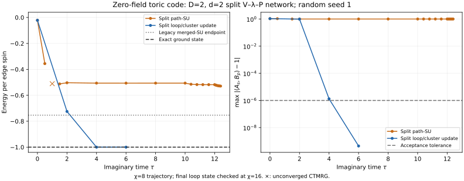

# 零场阶段总结：loop/cluster update 已得到基态

**主要结果：D=2 的 loop/cluster update 从随机 seed=1 出发，120 轮后得到 E/N=−0.999999999913340，最大稳定子误差为 4.4205×10⁻¹⁰。零场数值求解目标已经完成。**

模型为 H=−ΣₛAₛ−ΣₚBₚ，Jₑ=Jₘ=1，Aₛ=∏X、Bₚ=∏Z。主计算为无限平方晶格、物理自旋在边上；2×2 顶点重复单元包含 8 个物理自旋。严格零场基态应为 E/N=−1，全部稳定子为 +1。

## 已完成的算法比较

七月旧方法直接更新合并的 PEPS 张量，将 star 和 plaquette 都放在三个张量组成的 L 形区域中截断。十月新方法始终保留 V、P 和 λ：star 用四臂 HOSVD，plaquette 分别测试开放路径 path-SU 与完整闭环 loop/cluster ALS。两条十月随机轨迹使用完全相同的初态，与七月旧随机态不同。

| 方法 | 终点，每边自旋能量 | 当前结论 |
|---|---:|---|
| 七月 merged L 形 SU 重放 | −0.753303645768674 | 175 轮后权重稳定，仍不是基态 |
| 十月 split path-SU | −0.528972924089992 | 600 轮内未成功，终点仍在变化 |
| 十月 split loop/cluster update | −0.999999999913340 | 达到零场物理目标 |
| 七月 merged tied-tensor AD | −0.999999999383966 | 另一条已成功的零场数值路线 |

Loop 的环境 χ=8/16 测量差约 1.733×10⁻¹⁰/spin。χ=16 的 CTMRG residual 约 2.70×10⁻¹¹，所有稳定子均在 10⁻⁶ 目标以内。χ=8 的能量略低于精确值，偏差约 10⁻¹⁰，反映了收缩的数值误差。逐项数值见 [final_measurements.toml](simple-update/split/final_measurements.toml)。

图中旧 SU 的灰线只表示重放终点；path 和 loop 的轨迹可以直接比较。零场所有精确门对易，但有限 D 下的局部截断映射仍可有不同结果。

## 精确基准与 AD 结果的范围

解析 PEPS 使用 parity V 和 X-basis copy P，直接给出 E/N=−1、全部稳定子=1，用于检查模型、张量和测量。8-spin torus 的 ED 另给 E₀=−8、简并度 4、gap=4。

旧 AD 将一个 dense complex D=2 张量共享在四个位置，用投影梯度和 Armijo 步长优化。step86 的 E_cell=−7.999999995071725，最大 star/plaquette 误差约 5.95×10⁻¹⁰/6.37×10⁻¹⁰。同一张量从新环境重新收缩，E_cell 差约 6.49×10⁻⁹。优化在线搜索停止时结束，所得态已达到零场能量和稳定子目标。文件和数值见 [ad/merged/README.md](ad/merged/README.md)。

## 后续安排

接下来计算有限场基态，并完成显式虚拟 Z₂ 约束下的验证。旧 SU 停滞原因另见 [专题研究](research/su-stagnation/README.md)。
