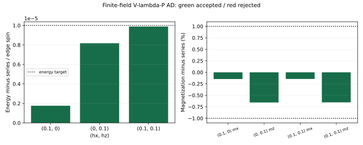

# 有限场阶段总结：弱场已有成功，完整路径仍待完成

**Loop/cluster update 已在三个弱场点得到基态近似，split AD 也在这三个点达到预定精度。接下来沿主轴继续计算更大磁场，再完成显式虚拟 Z₂ 约束和转移矩阵不同 sector 的谱。**

采用 H=−ΣA−ΣB−hₓΣX−h_zΣZ，Jₑ=Jₘ=1，Pauli convention，无限方格、边自旋、2×2 顶点重复单元。主观测量是每边自旋能量 e、磁化 mₓ/m_z，以及每个位置的稳定子。

## Loop/cluster update：当前主要方法

算法在场项半步之间执行 star 与 plaquette 更新：star 使用四臂 HOSVD，plaquette 使用完整八张量环的 ALS 拟合与 λ 重新分配。更新不使用 CTMRG；CTMRG 仅测量已有张量。三个 D=2 场点从同一组随机张量分别开始，D=3/4 则从对应较小 D 的结果增大连接维数继续计算。

| (hₓ,h_z) | D | e | 非零磁化误差 | 判断 |
|---|---:|---:|---|---|
| (0.1,0) | 2 | −1.002522276336 | mₓ约 −0.143% | 达到弱场精度 |
| (0,0.1) | 2 | −1.002515800057 | m_z约 −1.164% | 磁化未到 1% |
| (0.1,0.1) | 2 | −1.005034764851 | mₓ约 −0.139%，m_z约 −1.159% | Z 磁化未到 1% |
| (0,0.1) | 3 | −1.002519829374 | m_z约 −0.773% | 达到目标，χ=8/12 一致 |
| (0.1,0.1) | 3 | −1.005038775468 | mₓ约 −0.139%，m_z约 −0.770% | 达到目标，有独立 VUMPS 测量支持 |
| (0.1,0) | 3 | −1.002522762082 | mₓ约 −0.068% | 局部拟合和更大 χ 问题未解决，暂列待定 |
| (0.1,0.1) | 4 | −1.004887477064 | mₓ约 +4.55%，m_z约 −1.85% | 短计算未完成可靠优化，不接受 |

采用的精度目标是能量偏差≤10⁻⁵/spin、非零磁化相对偏差≤1%。D=2 双分量点将 dt 减半或 ALS 上限加倍后，Z 磁化偏差仍约 1.16%。D=4 只完成了短计算，尚待进一步优化。

参考来自 arXiv:1012.1740v2 补充材料十阶低场能量及其磁化导数，换算到 J=1。三个点的级数数值和阶数敏感性见 [model/reference.jl](model/reference.jl)、[reference_values.csv](simple-update/loop/reference_values.csv)。

## AD：三个弱场点的结果

Split AD 直接优化 V/P/λ。当前成功计算从解析零场或已有近基态出发，使用 unrolled AD，对固定次数的 CTMRG 迭代求导，并检查有限差分与迭代次数稳定性，得到下表结果：

| (hₓ,h_z) | e_AD | e_AD−e_series | mₓ | m_z |
|---|---:|---:|---:|---:|
| (0.1,0) | −1.002522276338 | +1.76×10⁻⁶ | 0.050899301286 | ≈0 |
| (0,0.1) | −1.002515864507 | +8.17×10⁻⁶ | ≈0 | 0.050639421385 |
| (0.1,0.1) | −1.005034828796 | +9.88×10⁻⁶ | 0.050830793213 | 0.050571570924 |

三点均满足能量 10⁻⁵/spin、磁化 1% 及相应的优化、收缩检查。从解析零场分别重新启动的完整四点批次也通过；随机全局寻优尚未通过。双分量能量误差约 9.88×10⁻⁶/spin，接近目标上限。所选数值来源见 [ad/split/selected_fields.json](ad/split/selected_fields.json)，细节见 [AD 报告](ad/split/REPORT.md)。

Loop 和 AD 的张量参数共享方式与起点不同。后续可从同一个 loop 态出发，在相同自由度下用 AD 继续优化，比较局部更新带来的误差。

## 收缩问题与下一步

同一张量曾得到多个环境解。对保存的 D=3 双分量态，先平衡 λ 而保持物理态不变，再分别求上下 boundary-VUMPS；主要观测量与此前 CTMRG 的差不超过约 1.25×10⁻¹¹。两种收缩都得到约 0.77% 的 Z 磁化偏差。

D=4 的较大 χ、上下 norm 一致性和原态优化均未得到充分控制，换用 VUMPS 没有使它通过。两种边界方法及有限周长圆柱的区别见 [VUMPS_REPORT.md](simple-update/loop/VUMPS_REPORT.md)。

后续按照 PLAN：以 loop 为主继续一条主轴有限场路径，再在已验证点施加显式虚拟 Z₂ 约束，比较基态精度，随后构造 transfer matrix 并计算不同 sector 的谱。
