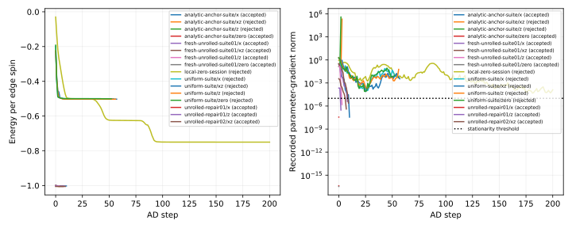
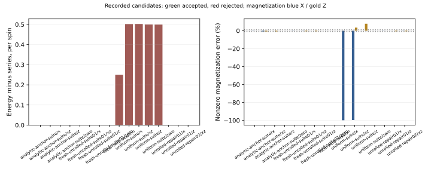

# Toric code 有限磁场基态：V–λ–P 网络的独立 AD 实验

本实验直接优化 V–λ–P 网络，先求未显式施加虚拟 Z₂ 约束的有限场基态，再为后续对称张量和转移矩阵谱计算作准备。

**当前结果：平移共享的 D=2 网络在三个弱场点达到预定精度，使用 χ=8 优化、χ=16 检查。** Unrolled AD 已通过初始和最终方向导数、迭代次数稳定性检查。从解析零场重新计算的零场和三个有限场点也全部通过；随机寻优和一般非对称起点的稳定性尚未通过。

## 1. 研究问题与计算设置

### 1.1 Hamiltonian 与能量单位

采用与 challenge 和后续 loop-update 实验一致的模型：

```text
H = −Σₛ Aₛ −Σₚ Bₚ −hₓΣᵢXᵢ −h_zΣᵢZᵢ
Aₛ = ∏_{i∈star s} Xᵢ
Bₚ = ∏_{i∈plaquette p} Zᵢ
Jₑ = Jₘ = 1
```

X、Z 是 Pauli matrices，不是含 1/2 因子的 spin operators。系统为无限二维
square lattice，physical qubits 位于每条 edge，单个 physical dimension d=2。
每个 vertex 对应两个 edge spins、一个 star 和一个 plaquette。因此零场严格值为：

```text
每 edge spin：e₀ = E₀/N = −1
每 vertex/composite site：−2
2×2 重复单元：8 个 edge spins，E₀,cell = −8
```

主计算是 thermodynamic-limit iPEPS。2×2 表示重复的 tensor cell，不是八自旋
有限环面的基态求解。测试中的 2×2 periodic wavefunction 仅用于核对网络重构
和算符作用，不能替代无限平面的收缩结果。

### 1.2 当前目标和保留的精度标准

首轮有限场点为 (hₓ,h_z)=(0,0.1)、(0.1,0)、(0.1,0.1)。主要比较每 spin 能量
e、磁化 mₓ/m_z，并检查所有 site-resolved stabilizers。标准在看结果之前确定：

| 条件 | 首轮标准 |
|---|---|
| 能量相对级数参考的绝对偏差 | ≤10⁻⁵ / edge spin |
| 非零参考磁化的相对偏差 | ≤1% |
| 零参考磁化的绝对偏差 | ≤10⁻⁶ |
| 有效参数梯度范数 | ≤10⁻⁵，并有有效求导/收敛证据 |
| 单轴 conserved stabilizer 偏差 | ≤10⁻⁶ |
| 任意局部 Pauli expectation 的绝对界 | ≤1+10⁻⁶ |
| 不同环境初始化及更大 χ 的能量差 | ≤10⁻⁶ / spin |
| 不同环境初始化及更大 χ 的局部观测量差 | ≤10⁻⁵ |

这些标准给出有限 D 的实用 ground-state approximation 验收，不是严格能量
认证。达到 step/time budget、Armijo 失败或 CTMRG residual 很小都不能代替
优化收敛；一个伴随求解失败后返回的有限数值也不能代替有效梯度。

## 2. Tensor setup：始终优化 V–λ–P，而非任意 merged PEPS

### 2.1 网络和参数化

| 对象 | 位置与指标 | D=2 时单个对象的 shape |
|---|---|---|
| simplex tensor V | vertex，N/E/S/W 四条 virtual legs | (2,2,2,2) |
| projection tensor P | edge，physical/tail/head | (2,2,2) |
| connection λ | 每条 V–P 连接的正值 diagonal weight | 长度 2 |

“Projection”是网络构件名称，不强制 P 为 isometry。V/P 使用实数 dense
参数，因为本轮 Hamiltonian 和既有 loop-update 基准均为实数问题。张量经
Frobenius normalization 后参与收缩，λ 用居中对数参数表示：

```text
V = V_raw / ‖V_raw‖，P = P_raw / ‖P_raw‖
λ = exp(u − mean(u))
```

λ 的整体尺度和张量尺度不影响归一化 observables；仍存在 internal gauge
redundancy，raw 参数数目不是独立物理自由度的严格计数。报告中的梯度范数指
这一明确参数化下、对 normalized tensor map 求导得到的 coordinate gradient，
未另行做完整 internal-gauge quotient projection，也不冒称 state variance。

### 2.2 独立位置与平移均匀版本

- **Independent cell**：四个 V、八个 P、十六条 λ 分别可变；D=2 共 160 个
  raw 参数。
- **Translation-uniform cell**：一个 V、一个 P_E、一个 P_N、四个 directional
  λ 精确复制到四个位置；D=2 共 40 个 raw 参数。四个位置的导数通过 AD 自动
  求和回共享变量，不使用旧 M2 的手工平均梯度代码。

平移均匀限制和虚拟 Z₂ 约束是不同的条件。本轮没有将 V 的奇宇称分量或 P 的
不同虚拟电荷分量删去。解析零场初始化本身有虚拟对称性，因此后续还需要小幅
通用扰动的对照，才能更充分检验非对称起点的恢复能力。

### 2.3 Blocking 和 measurement gauge

为了使用 PEPSKit，将每个 V 与其 outgoing east/north P 精确收缩，并将两个
d=2 physical legs 合成 dimension 4。简写为：

```text
T[pE,pN,n,e,s,w] = Σa,b V[b,a,s,w] P_E[pE,a,e] P_N[pN,b,n]
```

真实实现包含各 connection 的 λ；每条 λ 在完整网络中只出现一次。测量时将
√λ 分配到连接两端，改善 gauge 数值条件而不改变 wavefunction。这个 blocking
是可微的精确表示变换，后续从未把 T 作为任意独立变量放开优化，因而保持原
split-network 的内部 bond-rank 限制。

非均匀 λ 下的 scalar-loop 重构、balanced/unbalanced 的有限周期 wavefunction
恒等式及完整参数→TensorMap 的方向导数均有回归测试。

## 3. 能量、磁化和算符构造

每 cell 有四个 Aₛ、四个 Bₚ及八条 edges 的 X/Z。定义：

```text
e = −(mean⟨Aₛ⟩+mean⟨Bₚ⟩)/2 −hₓmₓ−h_zm_z
mₓ = Σ_edge⟨X⟩/8，m_z = Σ_edge⟨Z⟩/8
```

Hamiltonian 和逐项 observables 独立构造，不调用旧 M2 的构造函数。Julia 的
数组布局为 first-index-fastest，fused physical basis 中 pE 在前：
`X_E=kron(I,X)`，`X_N=kron(X,I)`，Z 同理。测试直接用 bit-level Pauli action
核对矩阵元素，避免由同一个 builder 同时生成实际值和“预期值”。

无限网络收缩采用 fresh SimultaneousCTMRG，记录收敛标志和 residual。PEPSKit
0.8 返回的 `contraction_metrics` 是最后一轮的 NamedTuple，不是 iteration
history；本轮不再从其 length 伪造 CTMRG iteration count。

## 4. 文献和严格零场基准

### 4.1 有限小场级数

参考 Dusuel 等 *Robustness of a perturbed topological phase*，PRL 106, 107203
(2011)，arXiv:1012.1740v2 补充 Eq.(1)，取 h_y=0。论文 J=1/2 转为本实验 J=1：

```text
e_ours(hₓ,h_z) = 2 e_paper(hₓ/2,h_z/2)
mₓ = −∂e/∂hₓ，m_z = −∂e/∂h_z
```

使用第十阶能量及其解析导数得到第九阶磁化。两个单轴的主参考相同：

| (hₓ,h_z) | e_ref | mₓ,ref | m_z,ref |
|---|---:|---:|---:|
| (0,0.1) | −1.002524034729 | 0 | 0.050973814624 |
| (0.1,0) | −1.002524034729 | 0.050973814624 | 0 |
| (0.1,0.1) | −1.005044710610 | 0.050904160373 | 0.050904160373 |

八阶/十阶能量差约为单轴 1.034×10⁻⁹、对角线 1.330×10⁻⁹；这是截断阶数
敏感性，不是严格余项上界或统计误差条。参考仅用于当前小场，不外推到临界区。
主 AD 程序共用 `../../model/reference.jl`
中的级数系数与解析导数。后续独立 boundary 诊断还导入 `../../simple-update/loop/` 的 `core.jl` 与
`vumps_core.jl`，用于 frozen-state adapter、边界求解和测量；未调用其中的
SU/ALS physical updates，也没有使用旧 AD 优化器。两类复用的边界分别记录。

### 4.2 解析零场态

原始构造为：

```text
V[n,e,s,w] = δ(n⊕e⊕s⊕w,0)
P[p,a,b] = δ(a,b) (−1)^(p a) / √2
λ = (1,1)
```

这是 physical Z basis 中的 X-basis copy。逐 tensor 的 normalization 只改变
整体标度。χ=8、seeds 2026/1/2 和 χ=16 的 fresh contractions 均给出 e=−1，
全部 stabilizers=+1 到约 2×10⁻¹⁵。独立 cell 的参数梯度范数约 4.1204×10⁻¹⁷，
uniform 版本约 4.1454×10⁻¹⁷。

依据文件为 `results/exact-calibration/calibration.json`、
`results/local-zero-session/exact.json` 与 `results/analytic-anchor-suite/zero/`。
解析态是明确标注的 benchmark/control；没有用于重启或修补随机主轨迹。

## 5. 第一阶段：fixed-point AD 和已经完成的实验

### 5.1 两段 AD chain rule

第一段对 PEPS 能量求完整 fixed-point 导数，包含环境响应；第二段通过精确
blocking 回传到 V/P/λ。拆分为了隔离构造器和编译边界，不是 frozen-environment
近似。参数化的 chain rule 由中心有限差分检查。

初始 independent random state 的两个随机方向和负梯度方向在 ε=10⁻⁴/10⁻⁵
下均通过，最大绝对差约 3.3×10⁻⁸。Uniform random suite 的四个 Hamiltonians
各做六个比较并通过，最大 ε=10⁻⁴ 差约 1.3×10⁻⁶，减小 ε 后改善。这只验证了
当时的导数，不能为后续非收敛伴随解背书。

### 5.2 随机初始化结果

Independent seed=19、D=2、χ=4 的 200 步达到 e=−0.749999364530，梯度范数
约 1.29065×10⁻⁴。两个 stars 近零，另两个近 +1；plaquettes 近 +1，m_z≈−0.25。
这是非基态，不应误写为“一个 plaquette 为 −1”。多个环境初始化和 χ=8
支持测得的模式，但有限预算失败不是数学上局部最小或所有随机起点均失败的证明。

随后 uniform seed=19 在四个场点均直接从同一随机参数出发，χ=8/16，旧每点
预算 120 秒。能量仍约 −0.50，优化未收敛，部分 χ check 也失败或不一致。
所有随机点均被拒绝；没有把近似正确的一个磁化分量当成基态证据。

### 5.3 解析锚点的有限场 controls

各点分别从解析 h=0 参数初始化，D=2、uniform、χ=8 优化、χ=16 检查，旧
每点预算 240 秒。结果不是随机寻优成功：

| (hₓ,h_z) | e_AD | mₓ | m_z | 结论 |
|---|---:|---:|---:|---|
| (0,0) | −1 到舍入精度 | ≈0 | ≈0 | 严格锚点通过 |
| (0.1,0) | −1.002522276338 | 0.050899301286 | ≈0 | 首轮精度下通过 |
| (0,0.1) | −1.002515858500 | ≈0 | 0.050560476748 | 伴随/优化失败，拒绝 |
| (0.1,0.1) | −1.005034078198 | 0.050493806225 | 0.050476969858 | 伴随失败且能量略超门槛，拒绝 |

X 单轴有十步 accepted updates，最后梯度范数 3.5836×10⁻⁸，能量偏差
+1.7584×10⁻⁶/spin、磁化偏差约 −0.1462%。Stars 守恒、operator bounds、
三个 χ=8 环境初始化和 χ=16 检查均通过。

Z 单轴的物理 candidate 已满足能量（+8.1762×10⁻⁶/spin）、磁化（约 −0.8109%）、
plaquette sector 及收缩检查。但 step 2 返回梯度范数约 3.85×10⁵，后一次评估
又约 4.93；这些不是有效 stationarity certificates。双分量点的能量偏差
+1.06324×10⁻⁵/spin，略超原阈值，磁化偏差约 0.81/0.84%，伴随梯度也异常。
没有因“很接近”而放宽阈值。





## 6. 为什么 forward contraction 通过，AD 仍会失败？

设环境满足 C=F(C,ψ)。隐式 AD 还需要处理环境 Jacobian J=∂F/∂C，伴随
问题具有 (I−Jᵀ)y=b 的结构。Forward residual 小，仅说明迭代达到一个固定点，
不保证伴随矩阵可逆或条件良好。Gauge 和不同 boundary fixed points 都可能
影响这个问题；具体谱结构尚未被独立测量。

旧 control log 明确给出 Arnoldi 辅助分量异常、可能存在非唯一单位特征值的
warning，随后 GMRES 在 30 iterations 后仍有巨大 residual。PEPSKit 仍返回
有限向量。旧程序只检查 `isfinite`，最终因 Armijo/梯度条件拒绝这些点，未将
不收敛伴随状态显式拦截。这个 API 边界已加入 `GradientFailure` 和日志捕获
回归检查；今后不会把已明确未收敛的返回向量继续当作有效梯度。

不能因此断言整个 AD chain rule 错误，也不能仅用更多迭代或算力保证修复。
必须在实际失败的 frozen tensor 上，核对能量对扰动的平滑性、环境分支与导数。

## 7. 当前修复阶段：固定次数展开的 AD 参照

### 7.1 明确的有限计算图

新增 unrolled AD 复用 PEPSKit `leading_boundary`，令 `miniter=maxiter=N`，
通过 `alg_rrule=nothing` 对真实迭代计算图反向传播。起始 C_ref 是冻结参考
环境；对每个 ψ±εδ 使用同一个 C_ref。没有对其伪造 dC_ref/dψ，也没有把这种
有限 N 导数直接宣称为严格无限固定点导数。

有限图能量写为：

```text
C_N(θ) = F_θ^N(C_ref)
e_N(θ; C_ref) = ⟨H⟩[ψ(θ), C_N(θ)] / 8
```

先检查 AD 是否与同一个有限图的中心差分一致，再检查 N=10/20/40 时能量和
梯度是否稳定，最后与 fresh converged CTMRG 的差分比较。这样才能区分
“计算图求导错误”和“有限图尚未代表可靠无限收缩”两种情况。

### 7.2 Frozen Z 点的诊断

`diagnose.jl` 使用 `analytic-anchor-suite/z/final.jld2` 的实际参数，不进行优化。
测量两个随机方向及 physical Z-filter 方向；ε=10⁻³/10⁻⁴/10⁻⁵。Fresh FD
同时核对 seeds 2026/1，记录不收敛，而非平均有分歧的能量。每个阶段即时写 JSON。

已完成诊断：`results/diagnostic-z-unrolled02/`。第一次启动只有中文日志插值的
parse error，在科学计算开始前退出；已修复并保留对应日志，不计作物理失败。

冻结 tensor 不变，将 fresh reference 的收缩 tol 收紧到 10⁻¹¹，得到 residual
6.80×10⁻¹³，e=−1.0025158585004035。此时原 fixed-point solver 没有报告失败，
梯度范数变为 2.17894×10⁻⁴，和展开 AD 接近。即能量几乎不变时，环境精度/
gauge 的数值差异仍可能强烈影响伴随求解；不能将此前巨大梯度当成真实下降方向。

| N | 展开梯度范数 | 与前一个 N 的全向量差 | 同图 FD 最大差 |
|---|---:|---:|---:|
| 10 | 2.17982×10⁻⁴ | — | 约 9.43×10⁻⁸ |
| 20 | 2.17742×10⁻⁴ | 2.42×10⁻⁷ | 约 1.45×10⁻⁷ |
| 40 | 2.17846×10⁻⁴ | 1.42×10⁻⁷ | 约 4.17×10⁻⁸ |

每个 N 的两个随机方向和 physical Z-filter 方向在 ε=10⁻⁴/10⁻⁵ 下都通过同图
FD。Physical Z-filter 的 fresh FD 约 −2.17612×10⁻⁴，对 ε=10⁻³→10⁻⁵ 稳定，
两个 fresh seeds 的能量差约 2.22×10⁻¹⁶，也与展开 AD 一致。

通用随机方向的 fresh 情况不同：ε=10⁻³ 时 seed 能量分歧约
1.69×10⁻⁶/3.93×10⁻⁶，超过声明的 branch consistency 门槛；更小 ε 时部分
环境 residual 接近但未达到严格 tol，另一些 seed 完全不收敛。因此不能声称整个
参数邻域的无限收缩都已经可靠。有限展开图的可微性验证、物理方向验证和通用
fresh 分支歧义分别记录，不平均或隐藏失败样本。

诊断总 wall 14m17s、peak RSS 约 3.23 GiB。首次旧求导编译占主要成本；缓存后
展开梯度 N=10/20/40 的调用约 6.1/2.6/3.8 秒。随后按已通过的近基态参照继续
三个 finite-field checkpoints，结果写入 `results/unrolled-repair01/` 和
`results/unrolled-repair02/`。

参数空间 geometric-sum 方法此前被提出，但还没有实施或验证。当前首先建立
用户批准的 unrolled AD 参照；没有暗中施加虚拟 Z₂，也没有计算任何 anyon sector。

### 7.3 有限场可靠优化与最终数值

先以 `unrolled-repair01` 继续原候选态。Z 点仅需两步，X 点复核即满足停止条件。
双分量点的导数测试通过，但其第一次 forward startup 因 probe/optimizer 的
1000/300 iteration cap 不一致被拒绝；这是配置问题，不是新物理失败。统一
上限 1000 后，以 `unrolled-repair02` 单独继续该点并在七步收敛。精度及物理
门槛没有放宽。

| (hₓ,h_z) | e_AD | e_AD−e_ref / spin | mₓ | m_z | 最终 N=40 梯度范数 |
|---|---:|---:|---:|---:|---:|
| (0.1,0) | −1.002522276338 | +1.7584×10⁻⁶ | 0.050899301286 | ≈0 | 3.58×10⁻⁸ |
| (0,0.1) | −1.002515864507 | +8.1702×10⁻⁶ | ≈0 | 0.050639421385 | 1.54×10⁻⁷ |
| (0.1,0.1) | −1.005034828796 | +9.8818×10⁻⁶ | 0.050830793213 | 0.050571570924 | 7.51×10⁻⁷ |

各非零磁化误差约为 X 单轴 −0.146%、Z 单轴 −0.656%、双分量 X/Z 约
−0.144%/−0.653%。所有行通过能量 10⁻⁵ 和磁化 1% 门槛。双分量能量只是刚到
这一实用门槛，不称为已经建立可控高精度。

每个最后 tensor 都重新计算导数，并比较 N=20/40；还在 N=40 做最终同图 FD
和 N=40/80 稳定性检查。近零梯度采用明确 absolute tolerance，不能要求随机
方向的两个近零数值“相对比例精确为 1”。Physical X/Z-filter 的 fresh FD
也通过。Final χ=8 seeds 2026/1/2 和 χ=16 的原始逐点 observables 全部保留。

最终导数证据的实测大小如下；FD 为 ε=10⁻⁴/10⁻⁵ 下所有已检查方向的最大
绝对差。N 比较使用全 gradient vector 的欧氏范数，声明 absolute 门槛为
2×10⁻⁶；同图 FD 使用 max(2×10⁻⁶,0.005|AD|)，physical fresh FD 使用 2×10⁻⁶。

| 场点 | ‖g₄₀−g₂₀‖ | ‖g₈₀−g₄₀‖ | 最终同图 FD 差 | physical fresh FD 差 |
|---|---:|---:|---:|---:|
| X 单轴 | 2.80×10⁻¹⁰ | 1.57×10⁻¹⁰ | 3.03×10⁻⁸ | 1.31×10⁻¹⁰ |
| Z 单轴 | 1.60×10⁻⁷ | 6.91×10⁻⁸ | 6.05×10⁻⁹ | 6.03×10⁻⁹ |
| 双分量 | 4.61×10⁻⁷ | 8.03×10⁻⁷ | 4.67×10⁻⁷ | 5.03×10⁻⁷ |

双分量的 N 差与最终近零梯度本身同量级，但仍低于声明的 absolute 容许值，
而各 N 的梯度均低于 stationarity 门槛。这支持本轮停止精度，不证明梯度相对
精度很高或 N→∞ 已严格收敛。三个 frozen-state audit 的能量 spread 分别为
4.44×10⁻¹⁶、2.22×10⁻¹⁶、2.22×10⁻¹⁶，局部 observable spread 均≤1.78×10⁻¹⁵。

主结果来源固定为 `selected_fields.json` 中三个路径，按预先指定的 continuation
cohort 选择，不按最低能量挑选。`frozen_states/{x,z,xz}.json` 保存完整 raw
parameters、field、D、梯度方法和 checkpoint hash；JSON round-trip 逐数字相等。


### 7.4 从解析零场重新跑通，而非仅修补旧检查点

`results/fresh-unrolled-suite01/` 使用完整新程序，每个 field 都从同一解析零场
参数独立出发，未使用旧 finite-field tensor，也未运行 simple update。N=20、
χ=8、tol=10⁻¹¹、forward maxiter=1000，每点 optimizer budget=3600 秒。
零场和三个有限场全部通过；三个 finite points 分别约 3/8/9 accepted updates。
重新运行的 energy/magnetization 与表中结果在声明预算内一致。

| fresh 场点 | accepted updates | e / spin | 最终 N=40 梯度范数 |
|---|---:|---:|---:|
| (0,0) | 0 | −1.000000000000 | 4.05×10⁻¹⁷ |
| (0,0.1) | 3 | −1.002515864507 | 1.68×10⁻⁶ |
| (0.1,0) | 8 | −1.002522276337 | 3.94×10⁻⁶ |
| (0.1,0.1) | 9 | −1.005034828795 | 2.44×10⁻⁶ |

此整批包含初始同图 FD、最终 N=20/40 和逐 seed/χ 检查；上述 continuation
cohort 另做了最终 N=40 同图 FD、N=40/80 和 physical fresh FD。两批的参数及
梯度不同，分别保留，不把 continuation 的额外检查称为 fresh suite 自动执行。

整批 wall 22m19s、peak RSS 约 3.62 GiB。可以从 fresh checkout 的已安装 Julia
stack 重现，因而历史 checkpoints 只是诊断资产，不是成功流程的必需起点。
解析初始化本身带有虚拟对称结构：这次结果证明“没有显式对称约束的参数化可
完成近基态有限场优化”，不是“任意非对称初值均可靠”。

### 7.5 通用扰动与环境主导性

对已接受 Z tensor，seed=71 分别加每个 raw V/P norm 的 0.1%/1% 通用噪声，
并扰动 log λ。未把噪声投影到对称子空间。测得虚拟 tensor symmetry defect
约 0.00181/0.0181，明确非零。

`perturb-preflight01` 的 fresh CTMRG 在不同 seeds/χ 下发生不收敛或物理量
分歧。因此先停止优化，改用同一 frozen state 的独立 boundary-VUMPS 测量。
这里只复用 sibling 的 boundary solver，未调用其 SU/ALS physical update。
输入 adapter 的 normalized blocked tensors 与本实验逐元素相等到 10⁻¹³。
上下 boundary 分别求解，使用非 Hermitian row MPO，两方向均无限长度。

VUMPS 也显示两个驻点分支；其中能量更低的分支 norm 增长率反而更小。较大
norm 的分支经 χ=8→16→32 boundary continuation，norm 和 observables 保持
一致。`dominance-preflight01` 的 CTMRG network_value 与这些 VUMPS 值吻合：

| 扰动 | 分支 | norm / cell | e |
|---|---|---:|---:|
| 0.1% | 较大 norm | 0.00390633818937 | −1.002507128543 |
| 0.1% | 较小 norm | 0.00390629486928 | −1.002514929450 |
| 1% | 较大 norm | 0.00390517037465 | −1.001643139964 |
| 1% | 较小 norm | 0.00390086679403 | −1.002421935583 |

对同一个 frozen tensor，换环境不是换 variational state，所以不能挑较低
energy 来宣布更好基态。较大 norm + 正反向相容 + χ continuation 给出主导性
支持，但不是严格全谱证明。所有随机失败、较小 norm 和正反向不一致的结果
都记录在 `boundary_summary.csv`、`dominance_summary.csv`，没有删掉。

新增 `dominant_contract` 实验路径按最高 norm cluster 选择。无 warm 环境时
至少需两个 fresh initializations 相容；带 warm 环境时要求至少两个支持者，
其中至少一个是 fresh initialization，最终 `dominant_audit` 在每个 χ 则要求
至少三个 fresh leading initializations。能量/磁化/physical bounds 的阈值不变。
非主导 solutions
明确标记 excluded，不再把它们和 leading solution 平均。这是 forward norm
求解的正确性处理，不是虚拟 Z₂ constraint。

`noisy-recovery01/02` 在 FD 附近无法得到足够独立 leading solutions，被明确
中止；没有发生 physical optimization，也不算恢复成功。`noisy-recovery03`
进一步使用已有 leading environment 的小步 continuation，同时仍要求 fresh
leading solution 匹配，不以 warm environment 单独为证据。

这次真正非对称起点的初始 fixed-point 梯度范数约 0.01462；两个随机方向和
负梯度方向对 ε=10⁻⁴/10⁻⁵ 的主导分支 FD 均一致到约 10⁻⁸，说明初始导数已
可靠。优化也确实降低能量，但更新后又遇到伴随求解不收敛，已被新 guard 中止。
最后独立 audit 未收集到足够多的 leading initializations；没有放宽计数条件。
整批约 51m49s、peak RSS 约 3.62 GiB，**恢复试验未通过**。

该批保存了 accepted-step 轨迹、`final.jld2`、原始 warning 和 failure message。
其旧版末端 audit exception 未生成完整 summary；已追加真实故障回归测试并
修复这一记录边界，今后的 audit failure 也会输出明确的拒绝 summary。这个
软件修复不反向改变该批的数值或验收结论。

因此当前已经实现的能力是：无显式虚拟约束参数化中的可靠近基态优化及三个
低场基准；一般非对称 tensor 更新后的稳定性与随机全局寻优仍是后续课题。
这些限制与“必须 impose Z₂ 才能计算基态”不是同一个判断。本轮未为了得到
通过结果而删去奇虚拟宇称或 off-diagonal P 分量。

## 8. 对偶性应该怎样用于判断？

Jₑ=Jₘ 时，全体 physical Hadamard 与原/对偶晶格的 star/plaquette 交换构成
精确对偶。真基态的两条单轴 e 和共轭磁化必须相同。单独交换代码里的 X/Z
名字，并不等于完成几何和张量表示的完整对偶变换。

目前 independently optimized 的 X/Z candidates 未被证明互为对偶态。
固定 D 的 vertex-centered split representation 和数值路径也未被证明严格
对偶封闭。因此，有限 D 近似误差不同不是 Hamiltonian 对偶性破缺的证据；
第一阶段 fixed-point Z control 未通过的直接原因是日志支持的伴随求解失败，
当前 unrolled Z 结果已经通过。两类问题需用相应检查定位，不能将历史上的
“X 通过、Z 未通过”解读为两方向真实物理不同。

## 9. 计算资源、软件问题和结果边界

Julia 1.12.6、TensorKit 0.16.5、PEPSKit 0.8.0、Zygote 0.7.12 等版本记录于
各 run 的 settings。全部科学计算本地执行，没有远程提交。

| 已完成批次 | wall time | peak RSS | 结论 |
|---|---:|---:|---|
| independent 零场诊断/优化 | 14m44s | 约 2.85 GiB | 非基态，拒绝 |
| uniform random 四点 | 20m15s | 约 3.08 GiB | 四点均拒绝 |
| fixed-point analytic-anchor 四点 | 18m31s | 约 3.16 GiB | 零场/X 通过，Z/双分量拒绝 |
| frozen Z unrolled 诊断 | 14m17s | 约 3.23 GiB | 同图/physical FD 通过，generic fresh 分支有歧义 |
| unrolled-repair01 | 13m08s | 约 3.90 GiB | X/Z 通过，双分量启动拒绝；整批 exit 1 |
| unrolled-repair02 | 15m00s | 约 3.65 GiB | 双分量通过；exit 0 |
| fresh-unrolled-suite01 | 22m19s | 约 3.62 GiB | 零场/三个有限场均通过；exit 0 |
| noisy-recovery03 | 51m49s | 约 3.62 GiB | 更新后伴随/最终 audit 失败；exit 1 |

第一次 objective/gradient 的时间约 100.94/550.68 秒，正常重复调用约
0.275/0.499 秒。首次编译显著高于稳定运行成本。降低优化级别、关闭个人 Revise
启动文件没有单独解决旧短预算的问题；不将冷启动超时当成 AD 数学错误。

已修复的构造器边界包括：InfinitePEPS 的常量空间/cache validation 被错误
纳入 AD；TensorMap 0.16 constructor pullback 返回完整五腿数组而非 (4,D⁴)
matrix；flattened generator 的内部 mutation；跨分支重绑定 captured parameter
导致独立版本的导数错误。每项都有相应测试，完整链也有实际有限差分证据。

当前用户允许数小时本地计算，不再要求十几分钟内完成。新任务仍有明确预算、
progress flush、incremental checkpoints 和内存监控。本机约 15 GiB RAM，
会以实测决定是否需要更多资源；仓库的所有集群配置已过时，禁止继续使用。
若需要课题组超算，先向用户报告工作量与时间/内存需求。

本阶段已完成三个低场基准和 fresh-run 重现，当前不需要超算支持这些计算。
仍不能声称随机全局寻优可靠、一般非对称 tensor 的更新均稳定、已完成一般 D
收敛或 transfer/anyon spectrum。若后续更大 D/χ 或很多起点需要资源，再按
实测向用户申请课题组资源；不使用本仓库的过时信息。

最终软件检查为 `tests.jl` 54 项、`gradient_tests.jl` 21 项、
`boundary_adapter_test.jl` 5 项和 `failure_control_test.jl` 11 项，均通过。
数学/物理证据主要来自真实有限差分、最后 tensor 的 N 检查及逐 seed/χ
measurements，而不是把这些测试数目作为基态证明。

交付阶段已再次串行运行以上四组测试，总计 91/91、exit 0，完整输出保留于
`results/final-verification.log`。同时对15 个 Julia 文件和 Python source 做语法
检查，对源码/文档/数据做 whitespace 检查，核对 Markdown links、SVG XML 与
PNG 图像。CSV writer 统一采用 LF 换行；重新生成前后四张表的解析数据逐项相同，
没有改动任何数值结果。主结果及 fresh 四点均从原始 audit measurements 重新
计算验收条件，而非只读取 saved accepted flag；source snapshot hashes 和三份
portable-state 的 summary/checkpoint hashes 均相符。

## 10. 文件、数据与复现

| 文件 | 功能 |
|---|---|
| `network.jl` | V/P/λ 参数化、blocking、初始化与独立算符 |
| `objective.jl` | fresh CTMRG、fixed-point/unrolled AD、物理与 χ/seed checks |
| `optimize.jl` | safeguarded L-BFGS/Armijo、轨迹与检查点 |
| `diagnose.jl` | frozen-checkpoint 导数与分支诊断 |
| `repair.jl` | 三个已保存 finite-field candidates 的可靠导数继续优化 |
| 原 `perturb.jl`、`dominance.jl`（已移除） | 当时的通用非对称输入、fresh branch/norm 检查，数据保留 |
| `boundary_check.jl` | 同一 frozen PEPS 的独立上下 boundary-VUMPS 与 χ growth |
| 原 `noisy_recover.jl`（已移除） | 当时的非对称恢复研究未通过，不再列为当前运行命令 |
| `export_states.jl` | 通过的数值状态导出及 JSON round-trip 核对 |
| `run.jl` | 显式参数 CLI、source snapshots 与输入 provenance |
| `tests.jl`、`gradient_tests.jl` | 网络、算符、chain rule、验收与失败求导边界 |
| `analyze.py` | 仅分析已有数据并绘图 |

`results/` 按仓库规则 gitignored。保留失败批次、settings、source snapshots、
原始逐步数据和 binary checkpoints；`summary.csv` 与 SVG 给出可保存的主要证据。
源码、参数、环境初始化及 source version 不同的批次不混称为同一次运行。

从 repository root 执行：

```bash
OPENBLAS_NUM_THREADS=1 julia --startup-file=no -O1 --project=julia-env tracks/peps/solutions/anyon-correlator/ad/split/tests.jl
OPENBLAS_NUM_THREADS=1 julia --startup-file=no -O1 --project=julia-env tracks/peps/solutions/anyon-correlator/ad/split/gradient_tests.jl
OPENBLAS_NUM_THREADS=1 julia --startup-file=no -O1 --project=julia-env tracks/peps/solutions/anyon-correlator/ad/split/boundary_adapter_test.jl
OPENBLAS_NUM_THREADS=1 julia --startup-file=no -O1 --project=julia-env tracks/peps/solutions/anyon-correlator/ad/split/failure_control_test.jl
OPENBLAS_NUM_THREADS=1 julia --startup-file=no -O1 --project=julia-env tracks/peps/solutions/anyon-correlator/ad/split/diagnose.jl tracks/peps/solutions/anyon-correlator/ad/split/results/analytic-anchor-suite/z/final.jld2 tracks/peps/solutions/anyon-correlator/ad/split/results/new-z-diagnostic 8
.venv/bin/python tracks/peps/solutions/anyon-correlator/ad/split/analyze.py
```

输出目录需为空；`diagnose.jl` 的 source checkpoint 必须已存在。耗时记录与
首次编译需分别阅读；诊断命令不会自动将失败候选态当成已接受基态。

**不依赖历史结果的主复现命令**，从 h=0 解析参数独立启动每个场点：

```bash
OPENBLAS_NUM_THREADS=1 JULIA_NUM_THREADS=1 julia --startup-file=no -O1 --project=julia-env tracks/peps/solutions/anyon-correlator/ad/split/run.jl suite --out=tracks/peps/solutions/anyon-correlator/ad/split/results/reproduce-unrolled --uniform=true --exact=true --gradient=unrolled --unroll=20 --ctm-tol=1e-11 --ctm-maxiter=1000 --chi=8 --chi-check=16 --seed=19 --maxsteps=400 --budget=3600
```

该形状的命令已经实际跑通；首次编译不计入每点 optimizer budget，整批另行
记录 wall time。输出数据是本机生成物，JSON frozen states 则可直接携带至另一
checkout 核对同一 numerical state。`selected_fields.json`、`summary.csv`、
`boundary_summary.csv`、`dominance_summary.csv` 明确列出各数据源和状态。
