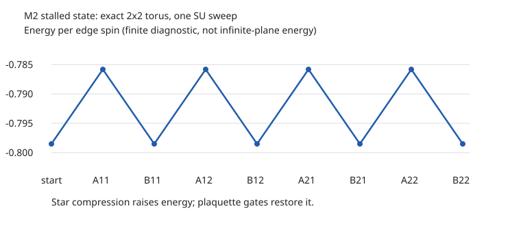

# M2 SU 独立单步审计：损伤发生在 star 的局部截断

## 结论

本次对旧 M2 seed=1、D=2、dt=0.05、175 sweeps 后的停滞态，定位到了具体的物理损伤：**star gate 本来应保持物理态，但其开放 L 形 cluster 的 D=2 截断改变了物理态，降低 plaquette 期望值。随后 plaquette gate 正确地改善该态，整轮的改善却被 star 更新的损伤抵消。**

这不是“merged T 不能拆回 V–P 所以失败”，也不是“plaquette gate 无法产生 loop correlations”。在这次停滞态上，plaquette 更新几乎没有截断误差，并与精确单门作用一致。

本结论定位的是这条已复现轨迹的停滞机制；没有证明所有初态都如此，也没有对 PEPSKit 的全部算法作正确性认证。

## 1. 设置与证据类型

- H=−ΣₛAₛ−ΣₚBₚ，Aₛ=X⊗4，Bₚ=Z⊗4，Jₑ=Jₘ=1，hₓ=h_z=0。
- 原 M2 dense complex merged PEPS，四条外部 bond D=2，2×2 重复单元。随机 V/P 用原流程 `Random.seed!(1)` 创建，随后一般 T 更新，不施加内部 split rank 限制。
- 精确重放 175 full SU sweeps，保留 tensor 和 SUWeight；不只保留 tensor，因为 weights 决定后续截断。
- 原 PEPSKit SU circuit 与 installed PEPSKit 的 `_get_cluster_with_weights`、`_get_allprojs` 用于被审查路径；独立 bit-level Pauli action 和 dense contraction 提供对照。
- **有限诊断**：把同一组 tensor 放在 2×2 torus，8 spins、256 个 amplitudes，精确收缩。它用于单门波函数比较，不冒充无限平面。
- **无限结果**：fresh CTMRG χ=8/16，seed=2026，tol=10⁻⁹，maxiter=250，核对关键前后态。所有本次保存的十二项关键收缩均返回收敛，χ 间结果一致。

同一 tensor 在有限 torus 的初始能量为 −0.798512901812，而无限平面为 −0.753303645769。两者不同，不能混用。

## 2. 不依赖 SU 的公式

### 2.1 一个 plaquette gate 的严格响应

对归一化有限态，B²=I，b=⟨B⟩，G=exp(dt B)：

```text
b_exact = ⟨B exp(2dt B)⟩ / ⟨exp(2dt B)⟩
        = [b+tanh(2dt)]/[1+b tanh(2dt)]
Δb_exact = (1−b²)tanh(2dt)/[1+b tanh(2dt)]
```

这是指定单个 gate 的公式。无限周期单元 tensor 更新会重复作用，不能直接把这个公式套到 CTMRG 的整轮数据。

### 2.2 已满足 star 的态应保持不动

```text
‖(A−I)ψ‖² = 2(1−⟨A⟩)
```

因此若 ⟨A⟩=1，则 Aψ=ψ，exp(dt A)ψ=exp(dt)ψ。归一化物理态不变。若只接近 1，应使用实际残差，不把小误差设为严格零。

本次 finite wavefunction 的精确 A gate 对照确实保持能量及全部稳定子到浮点精度。

## 3. 逐门数据：不是猜测的“竞争”

`audit.jl` 用同一个停滞态分出 full、plaquette-only、identity 和 isolated A/B 分支。下表是**精确 2×2 torus 诊断**：

| 步骤 | gate 前 e | 精确 gate 后 e | 实际 SU 后 e | 相对精确目标的 1−fidelity |
|---|---:|---:|---:|---:|
| full 第一个 A11 | −0.798512901812 | −0.798512901812 | −0.785822261465 | 0.00162426251648 |
| 紧随其后的 B11 | −0.785822261465 | −0.798512901812 | −0.798512901812 | 8.88×10⁻¹⁶ |
| 从原态单独 B11 | −0.798512901812 | −0.811235443715 | −0.811235443715 | 浮点精度内为零 |
| identity circuit | −0.798512901812 | 不变 | 不变 | 浮点精度内为零 |

四组 A/B 对都出现同样的能量升降。注意每对之后各位置的 B 值会重新分布，不能仅凭能量回到原值断言逐对波函数也回到原态。



例如第一个 A11 更新前后，四个 B 的精确有限观测量为：

```text
before: 0.571077886610, 0.571077886610, 0.622973720638, 0.622973720638
after:  0.557949086916, 0.557949086916, 0.612730830971, 0.557949086916
```

四个 A 始终为 1 到数值精度。损伤不是把态移出 A=+1 子空间，而是在该子空间内把 plaquette 关联变差。

### 无限网络核对

| 分支，均从同一停滞态出发 | χ=16 每 spin 能量 |
|---|---:|
| 更新前 | −0.753303645768674 |
| 单独 A11 SU | −0.744025472362519 |
| 单独 B11 SU | −0.762581819174899 |
| 完整一轮 A/B | −0.753303645768941 |
| 仅四个 B 的一轮 | −0.788508534358016 |
| identity 一轮 | −0.753303645768674 |

χ=8/16 一致到约 10⁻¹⁶；所有返回的 residual 约 3–4×10⁻¹⁶。具体原始稳定子和收敛标志保存在 `results/audit.toml`，不是只有能量。

因此 star 导致的能量上升也出现在无限网络，并非只由小 torus 造成。有限波函数不保真度仍只属于有限诊断。

## 4. 是 gate、截断，还是 λ 写回？

`stages.jl` 从完全相同的初态取出加权 cluster，显式分离各阶段。

1. **吸收 gate**：MPO 实现与直接 dense Pauli action 比较，A/B 相对误差分别为 4.44×10⁻¹⁶ / 5.72×10⁻¹⁶。
2. **不截断**：把增维张量接回有限环境。A/B 与精确物理 gate 目标的不保真度分别为 2.22×10⁻¹⁶ / 浮点精度内零。
3. **只截第一条连接**：A 的不保真度变为 0.00162426251648。
4. **只截第二条连接**：得到相同的损伤。
5. **两条都截**：仍为同样的损伤，并与完整库调用后的波函数一致到 10⁻¹² fidelity 容差。

单连接对照使用从同一个未截断目标生成的原库投影，不在第一次截断后重新计算第二个投影。

重构时外腿移除原来的 λ 权重，没有先把新的内部 λ 写回 SUWeight。损伤已经出现，所以不能把本次即时物理变化归因于“仅在 λ 更新后才出错”。内部新 weights 对后续轨迹仍可能重要。

## 5. 具体数学机制：全态恒等式不等于开放 cluster 恒等式

令 x 是 SU 吸收外部权重后的开放 L 形张量，C 是固定其余网络、并撤去这些外部权重后，将 x 接回完整有限态的线性映射。忽略整体标度：

```text
ψ = Cx
Aψ = ψ  ⇒  C(Ax−x)=0
```

这**不推出 Ax=x**。C 可以有非平凡核，完整网络中的抵消关系并不要求对每组独立开放虚指标成立。

本次直接测得：

```text
完整有限态：Aψ=ψ，数值精度内成立
开放加权 L cluster：‖Ax−x‖/‖x‖ = 0.768936177150
```

因此在 dt=0.05 时，SU 看到的局部目标 y=exp(dt A)x 并不是简单的 exp(dt)x：

```text
y = exp(dt)x + sinh(dt)(A−I)x
‖y−exp(dt)x‖/‖y‖ = 0.0370872152834
Cy = exp(dt)Cx
```

**在完整物理环境中可以相消的变化，在 SU 独立外腿的 Frobenius 度量中并不为零。** 这迫使 SU 为它所看到的局部增秩目标做截断，即使真实物理态根本不需要改变。

### 实际被截掉的谱

库对两条连接的 R L 做 SVD。下列谱均已用二范数归一化：

```text
A bond 1: 0.970200611079, 0.241911623322, 0.0133583869612, 0.00333080502922
A bond 2: 0.958884266858, 0.283463263946, 0.0132025757780, 0.00390291649565
```

截回 D=2 时，每条连接丢掉的平方权重约为 1.89540764347×10⁻⁴。这个数不等于全态不保真度，亦不等于库 `su_iter` 返回的归一化误差量。

反观 B gate：

```text
B bond 1/2 前两个值约为 0.958975153607, 0.283490131688
后两个值 ≤ 5.72×10⁻¹⁸
```

所以本次 B gate 的局部目标数值上已经是 rank 2，截断几乎不丢任何内容。

### 损伤从哪里进入物理态？

令拟合后的开放张量为 y_fit，局部误差 ε=y_fit−y：

```text
C y_fit = exp(dt)ψ + Cε
```

SU 的目标是让开放局部误差小，但真实物理误差由 Cε 决定。在本次计算中，Cε 不仅非零，而且含有与 ψ 不平行的分量；归一化后产生了实测的 0.00162426 不保真度。它不破坏 A=+1，却降低 B。

### 最直接的“优化错了度量”对照

两个候选都可用原 D=2 路径表示：一个保留原态 x，另一个采用实际 SU 截断结果。对每个候选允许最佳整体复数标度，开放局部误差定义为：

```text
ε_open(z) = min_α ‖y−αz‖²/‖y‖²
          = 1−|⟨y,z⟩|²/(‖y‖²‖z‖²)
```

| A11 后的 D=2 候选 | 开放局部 ε_open | 完整有限态 1−fidelity |
|---|---:|---:|
| 保留输入态，仅允许整体标度 | 0.00117214671218 | 数值精度内 0 |
| 采用实际 SU 两连接截断 | 0.000189540764346 | 0.00162426251648 |

**SU 选择的结果在自己的局部度量下更好，但在真实有限物理态上更差。** 这不是单纯“D=2 表达不下正确答案”：保留输入态就是一个 D=2、物理上正确的候选。错误来自两个度量对候选的排序不同。

因此现在有完整证据链：

```text
全网络 A=+1
→ 开放 cluster 却不是 A 的 +1 本征张量
→ 精确 gate 生成局部 rank-4 目标
→ 原 D=2 投影截掉非零方向
→ 接回真实环境后，原先应保持的物理态被改变
→ plaquette 关联下降
→ 后续 B gate 的改善被抵消，形成非基态的能量停滞
```

这里的“rank-4”是 **gate 后路径连接上的 Schmidt rank**，不是单个 merged T 内部的 V–P 可分解性。正常的增维—截断没有概念错误；问题是它优化的局部度量没有保留该输入态的全网络恒等式。

## 6. 对此前解释的修正

- **确认并具体化**：旧报告的 star/plaquette 截断竞争，在这个停滞态上有了逐门和分阶段证据。
- **否定**：不能用“merged T 不能拆回 split D=2”解释失败。这里直接定位到 star 路径的截断。
- **修正**：此前强调 plaquette 开环截断导致失败，不适用于这条旧 M2 停滞轨迹的即时机制；本次 plaquette 压缩近乎无损。
- **未建立**：star 更新等于某个简单的反向 plaquette gate。显式测试 exp(−dt B11) 的有限波函数对照，其不保真度约 0.00274722，不能把能量抵消误写成算符互逆。
- **不能直接外推**：新 split path-SU 仍需独立逐步检查。旧 M2 与新 path 的 star cluster 和截断方案不同。
- **对 loop 成功的解释边界**：loop 方法同时更换了 star 为完整四臂 cluster、plaquette 为闭环 ALS，并改变 gauge。它不经历本次相同的 L 形 star 投影；但本审计没有证明其中单一变化必然保证任意初态收敛。

## 7. 验证与执行记录

- `audit.jl` 的三个 oracle assertions 通过：解析态全部稳定子、随机态 A/B 单门响应公式。
- `stages.jl` 对 A/B 各检查 dense gate、原 cluster 重构、无截断重构、双投影与库结果等价，共八项断言通过。
- `analyze.py` 从原始数据重新断言逐门模式、χ 相容、operator bounds、旧能量复现与分支差别，执行通过。
- 初始运行遇到 TensorKit 的 `Array` 构造 API 不匹配，改为已有代码使用的 `convert(Array, ...)`；首次科学 pilot 在最后几项 CTMRG 之前被工具 200 秒时限终止，增量数据已保留，随后完整重跑成功。辅助脚本开发中的语法/命名错误已修复，报告数值来自最终成功运行。
- 未新增物理优化方法、未修改旧目录、未提交或推送。没有调用集群。

## 8. 文件与复现

所有命令从仓库根目录执行。输出写入本目录；重复运行会重建本审计结果。

```bash
OPENBLAS_NUM_THREADS=1 julia --startup-file=no -O1 --project=julia-env tracks/peps/solutions/anyon-correlator/m2-su-audit/audit.jl
OPENBLAS_NUM_THREADS=1 julia --startup-file=no -O1 --project=julia-env tracks/peps/solutions/anyon-correlator/m2-su-audit/stages.jl
.venv/bin/python tracks/peps/solutions/anyon-correlator/m2-su-audit/analyze.py
```

- `audit.jl`：重放、逐门 finite audit、identity control、无限 CTMRG。
- `stages.jl`：原库投影拆解、dense gate 核对、允许临时增维的精确有限收缩。
- `results/audit.toml`、`results/stages.toml`：全部原始数值。
- `results/stalled.jls`、`results/states.jls`：本地 checkpoint。
- `step_summary.csv`、`gate_cycle.svg`：可直接阅读的逐门表与图。
- `PLAN.md`：本次批准的审查范围。

`audit.jl --resume` 可在已生成 `states.jls` 时续做尚未保存的 CTMRG 项；若在该 checkpoint 生成前退出，应完整重跑。
