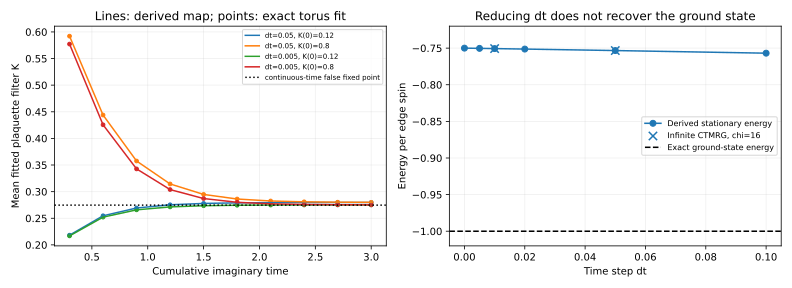

# Direction A：SU 的闭式更新映射与非基态吸引点

## 1. 本轮结果

**我们找到了一族 D=2、严格满足所有 Aₛ=+1 的态，将原 L 形 SU 的物理更新归约为小矩阵的 SVD，并推导出非基态固定点的闭式公式。** 该公式不拟合任何更新参数，预测旧 M2 的 dt=0.05 能量为 −0.753303645770674，与已记录的 −0.753303645768674 相差 2.00×10⁻¹²/spin。

在明确的截断分支上，小步长极限不是正确的虚时流，而是：

```text
dK/dτ = 1−2 tanh(2K)
K* = ln(3)/4
⟨Bₚ⟩* = 1/2
e* = −3/4
```

所以在这族态、这套局部环境/截断和更新顺序下，**单纯 dt→0 并不能消除停滞**。

本研究单独保存在 `research/su-stagnation/`，包含原始数据、更新公式、检查程序和图。

## 2. 设置与严格区分

- H=−ΣₛAₛ−ΣₚBₚ，Aₛ=X⊗4，Bₚ=Z⊗4，Jₑ=Jₘ=1，hₓ=h_z=0。
- 原 merged PEPS，四条外部虚腿 D=2；2×2 无限重复单元。
- 精确有限诊断：同一 tensors 放到 2×2 torus，8 spins、256 个 amplitudes；用于测量更新后的态及拟合误差。
- 无限平面：相关固定点另用 fresh CTMRG χ=8/16 核对；不将 torus 能量称为无限平面能量。
- 控制族以 |+⟩为明确参考，其有限环面的逻辑扇区由构造决定；没有用它重启或修改旧随机 M2 轨迹。
- 初始 pilot 和后续程序都单线程、600 秒进程 timeout、8 GiB virtual-memory cap；未调用集群。

## 3. 可控的精确态族

令：

```text
|ψ(K)⟩ ∝ ∏ₚ exp(Kₚ Bₚ)|+⟩
```

所有 Kₚ≥0。因为所有 Aₛ 与 Bₚ 对易，且 Aₛ|+⟩=|+⟩：

```text
Aₛ|ψ(K)⟩ = |ψ(K)⟩
exp(dt Aₛ)|ψ(K)⟩ ∝ |ψ(K)⟩
exp(dt Bₚ)|ψ(K)⟩ ∝ |ψ(K+dt·eₚ)⟩
```

这是精确虚时更新的 oracle，不依赖 SU。

### 3.1 D=2 dual-plaquette 表示

展开每个 filter：

```text
exp(K B) = cosh(K)I + sinh(K)B
a₀(K)=cosh(K), a₁(K)=sinh(K)
```

在每个 plaquette 上放一个二值 qₚ，q=1 表示选择该 B 项。X-basis 中每条 edge 的 bit 是两侧 plaquette bits 的 XOR。沿用原坐标，plaquette (r,c) 在 vertex (r,c) 的上右侧：

```text
k_E(r,c) = q(r,c) ⊕ q(r+1,c)
k_N(r,c) = q(r,c) ⊕ q(r,c−1)
```

令 H[p,k]=(−1)^(pk)/√2，所有指标取 0、1。张量为：

```text
T_K[pE,pN,n,e,s,w]
  = δ(n,e) a_n(K(r,c)) H[pE,n⊕s] H[pN,n⊕w]
```

n=e 复制当前 plaquette bit；s、w 是下方、左方邻居的 bits。四条虚腿仍为 D=2，blocking 后 physical dimension 为 4。

**它与原先的 parity-vertex V/P 表示不同，但表达的是上述明确的物理 filter 族。** 它故意把 star 恒等式的一部分放到 L cluster 外，适合解析旧审计中的机制。

`tests.jl` 对均匀、非均匀 K 检查：tensor wavefunction 与独立逐个施加 physical B gates 的 wavefunction 一致、全部 A=1、单个 B gate 对应 K shift。

### 3.2 有限与无限的 B 值

有限 torus 上 ∏ₚBₚ=I，所以：

```text
Z(K) = ⟨+|∏ₚexp(2KₚBₚ)|+⟩
     = ∏ₚcosh(2Kₚ) + ∏ₚsinh(2Kₚ)
ρₚ = tanh(2Kₚ)
⟨Bₚ⟩_torus = [ρₚ+∏_{q≠p}ρ_q]/[1+∏_qρ_q]
```

对于有限正 K 的无限重复网络，∏ρ→0：

```text
⟨Bₚ⟩_∞ = tanh(2Kₚ)
e_∞ = −1/2 − (1/8)Σ_{p in cell}tanh(2Kₚ)
```

固定点能量使用后一式，并有无限 CTMRG 对照。

## 4. 先把输入表示整理成明确的 SU gauge

对一条由 plaquette q 发出的连接，在源 tensor 端乘 a_q^(−1/2)，在邻居端乘 a_q^(+1/2)。两端相乘为 I，物理态不变。得到：

```text
T_bal[pE,pN,n,e,s,w]
  = δ(n,e) √[a_s(K(r+1,c)) a_w(K(r,c−1))]
    × H[pE,n⊕s] H[pN,n⊕w]
```

SUWeight 中携带该源 plaquette bit 的 north/east 两条连接取：

```text
λₚ ∝ diag(a₀(Kₚ),a₁(Kₚ)) ∝ diag(1,tanh Kₚ)
```

注意库的 tensors 已部分吸收 λ，不应再把这些 SUWeight 直接作为完整物理网络的额外 bond tensors 重复相乘。

`canonical_filtered_state` 直接构造此 gauge；另一路对原张量做 identity SU，数值上两 sweeps 达到 weights 固定点。两个来源均验证了后面的 star map。因此本反例不是仅由“未做任何 canonicalization 的初始 tensors”造成。

## 5. 为什么 star gate 在局部会产生一个 2×2 问题？

原 star L path 是 left、center、down 三个 T。其余两个相关的虚 bits 为：

```text
u = left tensor 的 south bit
v = down tensor 的 west bit
```

接回完整网络时，它们由未包含在 L path 内的 plaquette tensor 约束 u=v。于是：

```text
Aₛ → (−1)^(u+v)
完整网络：u=v ⇒ Aₛ=1
局部度量：u、v 被当作独立开放指标
```

该 missing plaquette 的坐标为 p=(r+1,c−1)。在上述 SU gauge 下，两端各带向量 a=(a₀,a₁)。Gate 后这部分开放目标为：

```text
M[u,v] = a_u a_v exp(dt·(−1)^(u+v))

M = [a₀² e^dt       a₀a₁ e^(−dt)]
    [a₀a₁ e^(−dt)  a₁² e^dt      ]
```

原 gate 对真实态只乘标量，但在独立两端的局部问题中，M 从 rank 1 变成 rank 2。

### 5.1 原路径连接的四个奇异值

每条 L path cut 还携带一个独立的 spectator plaquette bit。若其系数为 (c₀,c₁)，M 的奇异值为 μ₀≥μ₁，则该 cut 的谱（忽略共同标度）为：

```text
{c₀μ₀, c₁μ₀, c₀μ₁, c₁μ₁}
```

Hadamard physical factors和复制外指标给出正交的 row/column basis，所以它们不改变这些奇异值。`followup.jl` 从原库的 R L 矩阵提取谱，在三个 held-out K/dt 点直接与该乘积谱比较，最大差 7.46×10⁻¹⁶。

若两个 cuts 都满足：

```text
c₁/c₀ > μ₁/μ₀
```

保留前两个奇异值相当于保留 spectator 的两个方向，但只保留 M 的主通道。因此 M 被替换成 rank-1 近似：

```text
M_fit ∝ u uᵀ
```

这里 u 是 M 的正主特征向量。两个投影均来自同一个未截断目标；在此通道上重复插入不改变已经选出的 rank-1 分量。

## 6. 闭式 star map：不存在拟合参数

令 t=a₁/a₀=tanh K，忽略 a₀² 的整体标度：

```text
M ∝ [e^dt       t e^(−dt)]
    [t e^(−dt)  t² e^dt  ]
```

令 r=u₁/u₀。从主特征向量方程得到：

```text
t(1−r²) = e^(2dt)(1−t²)r
A = e^(2dt)(1−t²)/t
r = 2/[√(A²+4)+A]
```

压缩后去掉临时外部权重，两端分别出现 u_q/a_q。接回 missing tensor 时 u=v=q，其原系数 a_q 被改为：

```text
a′_q ∝ a_q (u_q/a_q)² = u_q²/a_q
t′ = a′₁/a′₀ = r²/t
F_dt(K) = atanh(r²/t)
```

所以原 star SU 的物理作用，在这个分支上是：

```text
K_missing → F_dt(K_missing)
其余 K 不变
```

它等价于对 missing plaquette 做一个反向 filter exp(−η B_missing)，η=K−F_dt(K)>0，而非正确 star gate 的标量作用。

### 对旧 M2 的直接波函数核对

旧停滞态的有限波函数可以拟合为本族：四个 K 约为
`(0.254710917175,0.254710917175,0.304710917175,0.304710917175)`，残差在数值精度内。

对旧 A11 更新，正确的反向算符位置是 **B22**，不是 B11。`legacy_check.jl` 直接比较：

```text
SU_A11 ψ  与  normalize[exp(−η B22)ψ]
dt=0.05: η=0.04999999999964，infidelity=0
dt=0.02: η=0.02102482539195，infidelity=4.44×10⁻¹⁶
dt=0.01: η=0.01069126217922，infidelity=0
```

这解释了此前审计中“反向 B11 gate 不匹配”的结果。该波函数等价检查只属于有限 torus；没有因此宣称旧 tensors 与本族在任意系统尺寸上严格 gauge 等价。旧无限稳定子/能量与下面的预测一致，是另一项独立证据。

## 7. 整轮更新与固定点

B update 在本族中几乎不截断，并精确实现 Kₚ→Kₚ+dt。

原循环按 r=1,2、c=1,2 遍历，各位置先 A 再 B。A(r,c) 改变 missing p=(r+1,c−1)，而 B(r,c) 改变自身 p。在保持主通道、输入 weights/gauge 与本族相容的轨道上，整轮 map 为：

```text
第 1 行：K → F_dt(K+dt)
第 2 行：K → F_dt(K)+dt
```

原 SU 的动态变量是 tensors **和 weights**；上述归约不是对任意 stale weights 或任意门序的宣称。本轮对原门序的 8 条完整轨迹验证了闭合；改变门序或反复施加同一 A 而不更新相关 weights，需要另行分析。

固定点可以写成两行：

```text
K_low = F_dt(K_low+dt)
K_high = K_low+dt
```

代入主向量方程，得到：

```text
e^(4dt) = cosh²(dt) sinh(2K_high)/sinh(2K_low)

b_low = tanh(2K_low)
      = sinh(2dt)/[e^(4dt)/cosh²(dt)−cosh(2dt)]

b_high = tanh[atanh(b_low)+2dt]
e* = −1/2 − (b_low+b_high)/4
```

dt=0.05 时：

```text
b_low  = 0.469494597916651
b_high = 0.543719985166046
e*     = −0.753303645770674
```

**这同时预测了旧 M2 的两组 B 值以及能量，不是只拟合了能量。** 与旧结果约 2×10⁻¹² 的差异与它有限 weights 停止精度相容。

## 8. dt→0 的错误连续时间流

在 dt=0 时 r=t。对主向量方程求 dt 导数：

```text
∂r/∂dt|₀ = −2t(1−t²)/(1+t²)
∂F_dt(K)/∂dt|₀ = −4t/(1+t²) = −2 tanh(2K)
```

整轮的 B 提供 +dt，所以：

```text
K_next = K + dt[1−2 tanh(2K)] + O(dt²)
dK/dτ = 1−2 tanh(2K)
```

正确虚时流应为 dK/dτ=1，向 K→∞、B→1 演化。SU 近似流却在：

```text
K*=ln(3)/4≈0.274653072167
B*=1/2
e*=−3/4
```

停止。其线性化导数为 −4 sech²(2K*)=−3；在该分支的连续时间方程内，这是真正的稳定吸引点，低于/高于它的正 K 分别向上/向下流动。

**单步 infidelity∼dt² 不否定一阶物理漂移。** 对归一化 filter 态，∂Kψ=(B−⟨B⟩)ψ，所以非零 dK/dτ 对应一阶态变化，而 infidelity 是该变化的平方。

## 9. 数值验证

### 9.1 未用于推导的输入与完整轨迹

- 3 个 held-out、非均匀或均匀 K/dt 点：闭式 map 对完整 SU 的 K 预测在 2×10⁻¹² 内；谱乘积公式也直接通过。
- 8 条轨迹：K(0)=0.12/0.8，dt=0.05/0.02/0.01/0.005，固定累计 τ=3。
- 每条轨迹 10 个 checkpoint，检查 B-eigenbasis 支撑及 log-amplitude 拟合。并非只用四个 B 期望值拟合。
- 80 个 checkpoint 中 map 最大 K 误差为 5.05×10⁻¹⁴，拟合未观察到新增两-plaquette 相互作用。
- τ=3 的轨迹只显示接近固定点，不冒充完全收敛；另从闭式固定点构造态，检查一整轮 physical wavefunction 保持。



### 9.2 固定点与无限测量

| dt | b_low | b_high | 解析无限 e* | χ=16 CTMRG |
|---:|---:|---:|---:|---:|
| 0.1 | 0.440619390056 | 0.586949262937 | −0.756892163248 | 未追加测量 |
| 0.05 | 0.469494597917 | 0.543719985166 | −0.753303645771 | −0.753303645771 |
| 0.02 | 0.487615274317 | 0.517505589320 | −0.751280215909 | 未追加测量 |
| 0.01 | 0.493778476785 | 0.508752261993 | −0.750632684695 | −0.750632684695 |
| 0.005 | 0.496882075535 | 0.504375673435 | −0.750314437243 | 未追加测量 |
| dt→0 | 1/2 | 1/2 | −3/4 | 解析极限 |

五个构造固定点的一轮 infidelity≤4.44×10⁻¹⁶。dt=0.05、0.01 的 χ=8/16 CTMRG 都收敛，与解析值一致到约 10⁻¹⁵。

## 10. 截断分支边界：不能把单一 map 无条件推广

令 γ=μ₁/μ₀。若某 cut 的 spectator ratio tanh(K_spec)<γ，前两个奇异值变成 c₀μ₀、c₀μ₁：保留两个 M 通道，但丢掉 spectator 的 q=1 方向。

对于从明确 canonical 输入开始的孤立 A11，四种严格非简并组合给出分段规则：

- 两个 cuts 都保留 M 的主通道：K22→F_dt(K22)，其他 K 保留。
- 一个 cut 保留主通道、另一个保留两个 M 通道：K22→F_dt(K22)，被牺牲的 spectator K→0。
- 两个 cuts 都保留两个 M 通道：K22 不变，两个 spectator K 都→0。

`branch_check.jl` 在 K22=1、dt=0.05、γ≈0.0460870 下测试四种组合，分段预测误差≤7.78×10⁻¹⁶。若错误使用单一 F map，最大 K 误差约 0.09166。

这表明 SU 的有限 D 选择不仅产生连续漂移，也有可解析的通道切换。**没有据此证明所有分段分支的长时间轨道、零权重边界或随机初态吸引域。** 特别是 K=0 的 rank-deficient 边界、奇异值恰好简并、不同门序，以及任意不相容 weights 都需要另行处理。

## 11. 对科研价值的更新判断

现在得到的不是只有“SU 环境近似不准”的说明，而是：

1. 明确物理态族与 D=2 表示；
2. 原库截断的局部谱分解；
3. 无拟合参数的非线性 map；
4. 原 M2 固定点的数值预测；
5. dt→0 仍非基态的连续流；
6. 初步分段通道边界。

这是方向 A 的实质进展，但**尚未做完发表级别的新颖性审查或一般性证明**。本轮只核对了相关 SU/BP、loop 更新及 topology 文献与少量针对性检索；不能把“检索未返回相同公式”当作原创性证明。

值得继续的研究问题：

- 建立整个 tensors+weights 系统在各门序下的严格不变族及分段动力学；
- 解释从随机 V/P 到该族的吸引机制，多 seeds 是否进入不同分支；
- 检验不同局部表示、实际 regauging、完整 star/loop 更新对这个流的改变；
- 第二个独立可控模型或表示上的推广。

没有在本轮直接改写 SU 求基态，也没有计算有限场或 anyon sector spectrum。

### 相关文献定位

- Alkabetz–Arad, PRR 3, 023073 (2021), arXiv:2008.04433：SU 的局部环境近似与 BP/Bethe 近似。
- Tindall–Fishman, SciPost Phys. 15, 222 (2023), arXiv:2306.17837：regauging、SU 环境与有环网络。
- Zheng–Yang, PRB 102, 075147 (2020), arXiv:1906.04085：保留 plaquette loop 的优化截断。

这些文献支持背景，不被当作本报告闭式 map 已知或未知的判断依据。

## 12. 复现、检查与资源

完整单进程复现命令（从仓库根目录）：

```bash
OPENBLAS_NUM_THREADS=1 JULIA_NUM_THREADS=1 julia --startup-file=no -O1 --project=julia-env tracks/peps/solutions/anyon-correlator/research/su-stagnation/dynamics/reproduce.jl
```

该入口复用安装栈，在独立 namespaces 中运行 tests、pilot、followup、branch check、legacy check，然后重新生成分析。缺失旧 binary checkpoint 时，在本新目录重放 175 sweeps 创建参考；不依赖手工提供历史 binary。

带 Linux 资源上限的实际验证使用 `ulimit -v 8388608` 和 `timeout 600`。完整入口实际跑通，exit 0，wall 3m41s，peak RSS 2,379,172 KiB（约 2.27 GiB）。这符合首批本地预算。

基础测试 38/38 通过；此外每条轨迹、固定点、CTMRG、分支与旧态反向-gate 检查包含真实物理断言。`analyze.py` 从原始结果重新核对数值，并保存当前源码的分析时 SHA-256（不是声称所有旧 run 都保存了运行时 source snapshot）。`legacy_check.jl --replay` 的强制重放也已通过，确认不是只有读取历史 checkpoint 的分支可运行。

脚本开发中的 import、analysis key 和分支测试 strict-threshold 错误已修复；最终结果来自完整成功入口。分支检查曾把预测的恰好 10⁻⁴ spectator 改变与严格 >10⁻⁴ 比较，现使用分段公式的直接预测误差与足够小的分支区分阈值。

文件：

- `core.jl`：物理 filter 族、显式 gauge、B-eigenbasis 拟合、闭式 map、legacy replay。
- `tests.jl`：独立 physical gate oracle、held-out map 和 gauge 检查。
- `pilot.jl`：单步 dt 扫描及短周期。
- `followup.jl`：谱、8 条 trajectory、5 个固定点、4 项无限 CTMRG。
- `branch_check.jl`：四种截断通道组合。
- `legacy_check.jl`：旧态对反向 B22 的直接波函数核对。
- `reproduce.jl`：完整入口。
- `summary.json`、`dt_scaling.csv`、`fixed_points.csv`、图：可保存的主要证据。
- `results/`：原始 JSON/checkpoints，按仓库规则忽略。

仅重新检查和绘图：

```bash
.venv/bin/python tracks/peps/solutions/anyon-correlator/research/su-stagnation/dynamics/analyze.py
```
