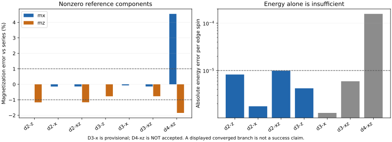
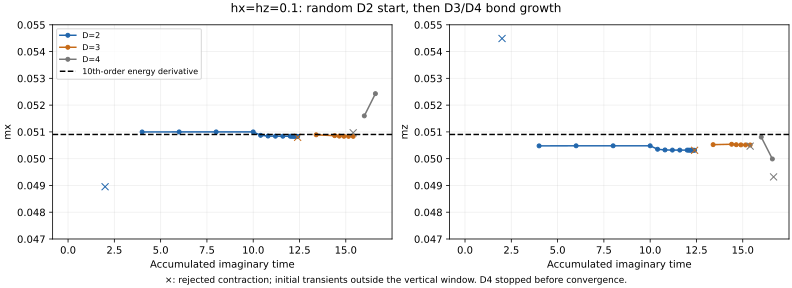
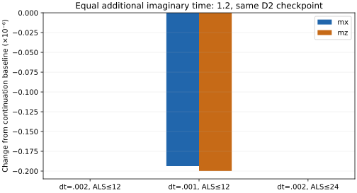
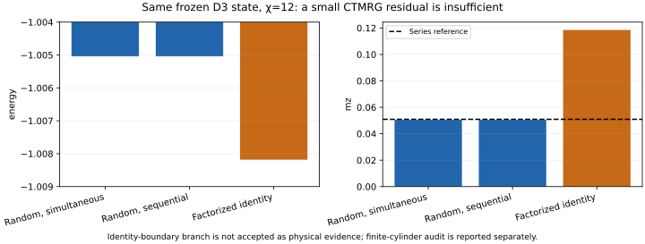

# 有限磁场下的 loop/cluster update：独立 benchmark 报告

本文记录有限场 loop/cluster update 的算法与结果，split AD 的弱场比较见 [AD 报告](../../ad/split/REPORT.md)。

> **第二轮补充：本地 boundary-VUMPS 冻结态核对已完成。** 见 [VUMPS_REPORT.md](VUMPS_REPORT.md)。Gauge balancing 后，D=3 的主候选分支在 χ=8/16、两个初始边界下稳定，与此前 CTMRG 的平均观测量差约 10⁻¹¹；因此约 0.77% 的磁化偏差获得了更强的独立测量支持。另一个较小 norm 的邻近分支被保留。D=4 虽可在 χ=16 达到迭代 residual，但 χ=24 未收敛，仍不接受为通过结果。下文保留第一轮实验记录。

## 1. 结论先行

**D=2 的 X 单轴、D=3 的 Z 单轴及双分量点达到能量 10⁻⁵/spin、磁化 1% 的目标；其余所测结果仍有精度或收敛问题。**

- D=2 的单轴守恒 stabilizer sector 保持到约 10⁻¹⁶，但 Z 磁化存在约 1.16% 的系统偏差；X 磁化偏差约 0.14%。
- D=3 的 Z 单轴和双分量点，主要磁化偏差降到约 0.77%，能量误差约 4.2–5.9×10⁻⁶/spin。D=3 X 单轴的候选结果更准确，但 ALS 上限和较大 χ contraction 问题使其仍为 provisional。
- D=2 的 dt 减半、ALS 轮数上限加倍没有消除方向偏差，因此不能简单归因于时间步或迭代轮数不足。
- D=4 双分量短延续没有稳定改善，出现较大的空间非均匀性、收缩分支敏感性，且运行被时间预算中止；**不接受为收敛结果**。
- 同一冻结态存在 residual 极小但物理上不可信的 CTMRG 分支。独立有限周长圆柱收缩提供了排查依据，但不能代替无限平面的完整误差控制。

本目录是相对于 [../split/](../split/README.md) 的独立有限场研究。旧零场脚本与结果不是本次更新的依赖项。

## 2. 物理设置与参考值

### 2.1 模型、张量与观测量

```text
H = −Σₛ Aₛ −Σₚ Bₚ −hₓΣᵢXᵢ −h_zΣᵢZᵢ
Aₛ = ∏X，Bₚ = ∏Z，Jₑ=Jₘ=1
无限 square lattice，spins on edges，Pauli convention
2×2 vertex unit cell，8 个 physical spins
V[N,E,S,W]：D⁴；P[p,tail,head]：2D²；每个 V–P bond 一个 diagonal λ
```

三个场点为 `(hₓ,h_z)=(0,0.1),(0.1,0),(0.1,0.1)`。所有新计算保持 physical dimension d=2；只在 CTMRG 测量时精确 block 成 d=4 composite PEPS。主观测量是每 edge spin 平均的 mₓ、m_z，并保留全部四个 stars、四个 plaquettes、八条 edges 的 X/Z。

能量采用：

```text
e = E/N_edge_spins = −(mean⟨Aₛ⟩+mean⟨Bₚ⟩)/2 −hₓmₓ−h_zm_z
```

### 2.2 文献 benchmark 与误差意义

主参考来自 Dusuel 等，*Robustness of a perturbed topological phase*, PRL **106**, 107203 (2011)，[arXiv:1012.1740v2，补充 Eq.(1)](https://arxiv.org/pdf/1012.1740v2#page=5)。取 h_y=0，按 `e_ours(hₓ,h_z)=2 e_paper(hₓ/2,h_z/2)` 转成 J=1。

磁化使用能量级数的解析导数：`mₓ=−∂e/∂hₓ`、`m_z=−∂e/∂h_z`。十阶能量给出九阶磁化。单轴守恒 stabilizer 取 +1；另一类通过能量恒等式得到。对角线依靠基态 self-duality，⟨Aₛ⟩=⟨Bₚ⟩。

| (hₓ,h_z) | e⁽¹⁰⁾ | mₓ | m_z | ⟨Aₛ⟩ | ⟨Bₚ⟩ |
|---|---:|---:|---:|---:|---:|
| (0,0.1) | −1.002524034729 | 0 | 0.050973814624 | 0.994853306533 | 1 |
| (0.1,0) | −1.002524034729 | 0.050973814624 | 0 | 1 | 0.994853306533 |
| (0.1,0.1) | −1.005044710610 | 0.050904160373 | 0.050904160373 | 0.994863878536 | 0.994863878536 |

八阶与十阶能量的差，在单轴为 1.034×10⁻⁹，在对角线为 1.330×10⁻⁹；对应非零磁化导数的差分别为 1.034×10⁻⁷、6.648×10⁻⁸。**这些是 truncation-order sensitivity，不是严格余项上界或统计误差条。** 当前约 10⁻⁴–10⁻³ 的磁化偏差显著大于这一敏感性。

Wu–Deng–Prokof’ev 的 [arXiv:1201.6409](https://arxiv.org/abs/1201.6409) 用 QMC 对低场的稳定子和磁化提供了独立支持，但本次没有将其曲线读图值冒充高精度能量表。完整逐项参考及导数在 [reference.jl](../../model/reference.jl)；数值在 [reference_values.csv](reference_values.csv)。

### 2.3 预先声明的实用目标

[整体 PLAN](../../PLAN.md) 中保留的第一轮实用目标为：非零磁化相对偏差约 1% 内、能量误差约 10⁻⁵/spin 内、单轴 conserved sector 偏差约 10⁻⁶ 内，并检查物理量对数值设置的稳定性。

这些是本次算法 benchmark 的目标，不是文献提供的 certified uncertainty，也不是要求所有固定 D ansatz 都必须满足的定理。结果同时给出绝对误差，不以“接近 −1”替代磁场响应验证。

## 3. 算法与实现检查

### 3.1 有限场演化

保留零场已测试的四臂 HOSVD star update，以及完整八张量 plaquette 的 ALS compression、diagonal 外部 λ、BP regauging。Field gate 精确作用在 P 的 physical leg：

```text
h = √(hₓ²+h_z²)
G_h(dt) = cosh(dt h) I + [sinh(dt h)/h](hₓX+h_zZ)
```

h=0 时取 I。每个 sweep 使用：

```text
field 半步 → 四个 star 与四个 plaquette gates → field 半步
```

在不截断时，这是 field 与 stabilizer 部分的二阶 splitting；有限 D 压缩会引入额外误差，不能直接假设所有观测量都按 dt² 外推。更新时不使用 CTMRG；CTMRG 只测量冻结态。

### 3.2 初始化与 D-continuation

- D=2：三个场点从同一组逐位置独立 Gaussian real tensors 出发，`MersenneTwister(1)`，初始 λ=(1,1)。
- D=3：从各场点的 D=2 终点放大，而不是独立随机 D=3 重新开始。旧 tensor block 原样嵌入，新增部分为 amplitude 10⁻³ 的随机扰动，新增 λ=10⁻³ 后归一化，增长 RNG seed=71。
- D=4：从 D=3 双分量终点同样扩大。所有高 D 结果因此是来自随机轨迹的 bond-growth continuation，不是 analytic-state 初始化，也不能当作多 seed basin survey。

### 3.3 对 ALS 和 λ 分别记账

每次 plaquette update 记录：拟合前后 residual、ALS 轮数和是否达到停止条件；BP 实际 fixed-point residual、轮数和停止标志；regauging 前后重构态的相对误差。

`gauge_error` 比较的是已完成 ALS 的环，在恢复 Γ–λ 表示前后的归一化张量。因此它与 gate→fixed-D 的物理压缩误差分开。被记录的更新中，拟合目标未观察到上升；D=2 的 gauge error 通常为 10⁻¹⁵，D=3 终点为 10⁻¹⁴ 左右，D=4 晚期可达约 10⁻¹²。它们不能证明全局能量必然下降。

### 3.4 更大 D 的等价性能优化

直接把七个环境张量展开成很高的 least-squares design matrix，D=4 实测约 99 秒/sweep。改为沿环境路径做**不截断的 QR**，求解等价的小系统，并用平衡的两半收缩形成闭环张量后，降到约 1.87 秒/sweep；D=3 约 0.34 秒/sweep。这些是更新 pilot 的测量，不包括 CTMRG。

QR 没有改变 least-squares 目标，没有改成平方条件数的 normal equations，也没有额外截断。D=2/3 的随机局部张量上，压缩和 dense ALS 的拟合结果直接对照通过；此外，优化后的代码从随机态重跑了三个完整 D=2 轨迹，复现了原 dense-ALS 终点。

`tests.jl` 当前 **34/34** 检查通过，包括独立 matrix exponential、physical-axis 作用、D=2/3 gauge 重构、dense/QR ALS 等价、series 数值与高精度 finite-difference 导数。圆柱收缩还有独立的 exact-state 控制，得到 e=−1、mₓ=m_z≈0。

## 4. 随机有限场结果

### 4.1 主结果表

下表使用 [benchmark_summary.csv](benchmark_summary.csv) 中明确指定的 frozen-state contraction 分支。**能量/磁化列是候选态的测量，不表示每行都通过完整验证。**

| 场点 | D | e | 非零磁化及相对参考误差 | 状态 |
|---|---:|---:|---|---|
| (0,0.1) | 2 | −1.002515800057 | m_z=0.050380724663，−1.164% | 收缩稳定，未达到 1% 磁化目标 |
| (0.1,0) | 2 | −1.002522276336 | mₓ=0.050900846179，−0.143% | 达到本次实用目标 |
| (0.1,0.1) | 2 | −1.005034764851 | mₓ=0.050833362519，−0.139%；m_z=0.050314242989，−1.159% | 收缩稳定，Z 响应仍有偏差 |
| (0,0.1) | 3 | −1.002519829374 | m_z=0.050579833642，−0.773% | 改善，χ=8/12 一致 |
| (0.1,0) | 3 | −1.002522762082 | mₓ=0.050939007992，−0.0683% | **Provisional**：较大 χ、ALS 问题仍在 |
| (0.1,0.1) | 3 | −1.005038775468 | mₓ=0.050833505425，−0.139%；m_z=0.050512355906，−0.770% | 有条件支持低场近似有效，见 contraction 审查 |
| (0.1,0.1) | 4 | −1.004887477064 | mₓ=0.053218568341，+4.547%；m_z=0.049964746992，−1.845% | **未接受**：未收敛、分支敏感、时间中止 |



**图 1｜磁化比能量更敏感。** D=2 的能量已到约 10⁻⁵/spin，但 Z 响应仍偏差约 1%。D=3 有改善。D=4 的柱子仅展示未接受 checkpoint 的一个分支，不表示已收敛的 D=4 性能。

### 4.2 单轴 conserved sectors

- hₓ=0：所有 Bₚ 应为 +1。D=2 与 D=3 的最终最大偏差均约 4.44×10⁻¹⁶。
- h_z=0：所有 Aₛ 应为 +1。D=2 和所列 D=3 分支的最大偏差约 3.33×10⁻¹⁶。
- 零参考磁化分量也接近零：D=2 为约 10⁻¹⁶；D=3 Z 单轴的 mₓ约 −6.5×10⁻¹³。

这支持 finite-field gates、operator incidence、conserved-sector 演化在这些轨迹上工作正确。它不能替代非零磁化的定量比较。

### 4.3 对偶关系并没有精确恢复

模型对交换 hₓ↔h_z 并交换 star/plaquette 具有电磁对偶。两个单轴参考磁化均为 0.050973814624，但 D=2 结果相差约 5.20×10⁻⁴。

在 self-dual 场点 (0.1,0.1)，D=2 的 `mₓ−m_z≈5.19×10⁻⁴`；D=3 降到 `3.21×10⁻⁴`，但仍明显非零。其原因可能包含 split ansatz 的表示偏置，以及 star HOSVD/plaquette ALS 的不对称近似。当前实验没有将二者单独隔离，不能直接将对偶偏差归咎于某个代码 bug。



**图 2｜同一随机起源的 D=2→3→4 轨迹。** 横轴为累计 imaginary time。× 表示该次测量不被接受；纵轴聚焦最终响应区间，所以很早的随机态不在显示范围内。增大 D 改善了 D=3 的 Z 响应，但 D=4 没有在短运行中稳定改善，不能假设 SU-like 演化随 D 单调变好。

## 5. dt、ALS 与 χ 的稳定性

### 5.1 D=2 双分量点：等追加 τ 的控制

从同一个 step-600 checkpoint 分出三条分支，全部再演化 τ=1.2。最终使用 fresh χ=16：

| 分支 | e | mₓ | m_z |
|---|---:|---:|---:|
| dt=0.002，ALS≤12，600 sweeps | −1.005034764196 | 0.050832023159 | 0.050312919985 |
| dt=0.001，ALS≤12，1200 sweeps | −1.005034764097 | 0.050831829417 | 0.050312720124 |
| dt=0.002，ALS≤24，600 sweeps | −1.005034764196 | 0.050832023159 | 0.050312919985 |

dt 减半仅改变磁化约 1.94×10⁻⁷、2.00×10⁻⁷，能量约 9.93×10⁻¹¹；增加 ALS 上限得到相同结果，实际大多在约 3 轮停止。因而约 5.9×10⁻⁴ 的 Z 响应偏差并不是这两个设置不充分造成的。



**图 3｜控制变量对照。** 纵轴以 10⁻⁶ 为单位，显示相对于继续原 dt 的变化；三条分支具有相同追加 imaginary time。

### 5.2 D=3 的补充检查

- 双分量点从 dt=0.005 改为 0.0025，额外演化 τ=0.5，在相同 χ=8 比较下 mₓ、m_z 分别改变约 −1.52×10⁻⁶、−1.80×10⁻⁶。这个值还混有额外演化时间，**不是严格等 τ 的单变量 dt error estimate**，但比约 3.9×10⁻⁴ 的 Z 偏差小得多。ALS 仍约 9 轮收敛。
- X 单轴末端经常达到 ALS 12 轮上限。相同起点的额外 τ=1.0、ALS≤24 分支依然经常用完 24 轮；mₓ约 0.0509340，未显示干净的 ALS convergence。ALS≤12 的同长度终点还遇到未收敛 CTMRG。
- 因此 D=3 X 单轴只列为 provisional，而不是从多个分支里挑一个较低能量就宣布通过。

### 5.3 数值收敛的范围

D=2 的三个主终点 χ=8/16 一致，误差远小于其磁化 benchmark 偏差。D=3 Z 单轴的 χ=8/12 一致。

D=3 双分量点，χ=8→12 的 mₓ变化约 9.1×10⁻⁷，能量变化约 9.0×10⁻⁸；在 χ=12，simultaneous 与 sequential CTMRG 都收敛并给出一致物理量。χ=16/20 的观测量也很接近，但 residual 未达到原定 10⁻⁹，所以保留未收敛标志。

这足以支持“当前候选分支下约 0.77% 的磁化误差不是普通 χ=8→12 测量变化造成的”，却不构成所有初始环境、所有 χ 下均稳定的证明。

## 6. CTMRG 分支问题与独立圆柱诊断

### 6.1 小 residual 可以是假安全信号

实际 D=3/4 contraction 失败后，额外检查了一个 factorized identity norm boundary。这是环境初始化，不是新的物理初态。对同一冻结 D=3 双分量态：

| CTMRG 设置 | e | m_z | residual / 状态 |
|---|---:|---:|---|
| 随机 seed2026，simultaneous，χ=12 | −1.005038775468 | 0.050512355906 | 9.75×10⁻¹⁰，收敛 |
| 随机 seed17，sequential，χ=12 | −1.005038775466 | 0.050512355881 | 5.48×10⁻¹⁰，收敛 |
| Factorized identity，χ=12 | −1.008181542334 | 0.118534827549 | 7.52×10⁻¹⁵，显示收敛，但**未接受** |

最后一行在 χ=8、12、16 几乎完全不变，且单个 Pauli/stabilizer 期望值也没有超过 ±1，但磁化和能量与其他证据严重不符。因此仅检查 residual、χ 不变、operator bounds，都不足以保证不同局部 RDM 来自正确的无限网络 contraction。



**图 4｜Environment fixed point 不等于已验证物理结果。** Factorized identity 初始化可能将迭代限制在不可靠的环境解中。这里不把它的更低能量作为更好的变分态，因为张量根本没有改变。

### 6.2 Circumference-4、无限长度 transfer matrix

为独立检查局部观测量，构造了固定 circumference W=4 的 double-layer row transfer matrix。横向四列精确收缩，纵向取无限长度的主左右 eigenvectors；没有使用 CTMRG 或 λ-only environment。Near-topological sectors 使 power iteration 很慢，因此用经过标度归一化的 Krylov eigensolver 收敛主本征态。

Exact zero-field control 给出 e=−1、mₓ=m_z≈0。三个冻结态的结果为：

| 冻结态 | e，W=4 cylinder | mₓ | m_z | 左右 eigen residual |
|---|---:|---:|---:|---:|
| D=2 双分量终点 | −1.005041497378 | 0.050904946736 | 0.050379488523 | <5×10⁻¹⁶ |
| D=3 双分量终点 | −1.005046957365 | 0.050903387830 | 0.050610824592 | <3×10⁻¹⁵ |
| D=3 X 单轴终点 | −1.002526676542 | 0.051036884550 | ≈0 | <2×10⁻¹⁶ |

这些结果与合理随机 CTMRG 分支的量级相近，与 m_z≈0.1185 的 identity-boundary 分支明显不符。但 W=4 是**不同边界问题**，会改变 sector selection 和局部观测量；其能量也可以低于无限平面参考。它不是新求得的有限圆柱基态，更不是用来替代主 benchmark 的无限二维答案。

没有做 W→∞ 外推，因而这一步定位了严重分支不一致，却没有严格认证无限平面数值的每一位小数。

## 7. D=4、资源与本次工作边界

### 7.1 D=4 实际完成了什么

从 D=3 双分量 step900、τ=15.4 的 checkpoint 增长到 D=4，计划 dt=0.02×60、0.005×60。实际完成前 60 sweeps 和后一阶段 13 sweeps，停止于 step973、τ=16.665。

在过程中 mₓ偏差增大、空间非均匀性增加。最终同一 checkpoint 的随机 simultaneous χ=8 给 e≈−1.00489818，sequential χ=8 给 e≈−1.00488748，χ=12 仍未收敛。Selected branch 的最大同类 site observable spread 约 0.041，这本身也说明该短运行远未建立可靠的均匀低场 ground state。

所以这里只能说“**本次 D=4 延续没有通过验证**”，不能证明 D=4 最优 ansatz 不如 D=3，也不能证明充分收敛的 loop update 必然失败。ALS 截断度量、扩大 D 的初态、优化轨迹和 contraction 都仍可能影响结果。

### 7.2 资源实际情况

Active SCNet profile 可读，但 SSH 返回 authentication failure，因此没有向集群提交任务。通过等价的局部 QR 与平衡 contraction，将 D=3 的有界任务压到数分钟范围，在本地完成。

D=4 的 update-only pilot 较快，但实际 CTMRG 比预估昂贵。`max-seconds=420` 是单次更新/测量返回后才检查的软预算；该运行在某次测量后超过软预算，随后又在 final CTMRG 阶段触及 600 秒外部 timeout。Checkpoint 和已写 CSV 保留，恢复的 `summary.toml` 明确标为未完成 final audit，没有编造缺失的耗时或成功标志。

今后更长的 D=4 轨迹应重新估算资源，或先进一步降低 contraction 的成本；旧集群信息已停用，不再恢复其认证。本报告不把未完成的运行包装成 D-convergence study。

### 7.3 尚未执行的独立优化对照

此前讨论的“在同一 V–λ–P ansatz 上进行独立 variational optimization”尚未执行。因此目前不能把稳定的有限 D benchmark 偏差，唯一拆分成 ansatz error 与局部 update error。较低能量的不同 D 或不同算法结果不自动定位代码 bug。

## 8. 复现与文件

### 8.1 推荐入口

所有命令从 repository root 执行。现有栈为 Julia 1.12.6、PEPSKit 0.8.0、TensorKit 0.16.5，BLAS threads=1。

```bash
# 三个 D=2 点
OPENBLAS_NUM_THREADS=1 julia -O1 --project=julia-env tracks/peps/solutions/anyon-correlator/simple-update/loop/reproduce.jl d2
# 等追加 τ 的 dt/ALS 对照
OPENBLAS_NUM_THREADS=1 julia -O1 --project=julia-env tracks/peps/solutions/anyon-correlator/simple-update/loop/reproduce.jl stability
# 三个 D=3 点，分别作为有界任务
OPENBLAS_NUM_THREADS=1 julia -O1 --project=julia-env tracks/peps/solutions/anyon-correlator/simple-update/loop/reproduce.jl d3-z
OPENBLAS_NUM_THREADS=1 julia -O1 --project=julia-env tracks/peps/solutions/anyon-correlator/simple-update/loop/reproduce.jl d3-x
OPENBLAS_NUM_THREADS=1 julia -O1 --project=julia-env tracks/peps/solutions/anyon-correlator/simple-update/loop/reproduce.jl d3-xz
```

上述入口使用最终等价优化核心。原 D=2 dense-ALS 结果另由 `qr-recheck` 从头复现，保存于 `results/d2-*-qr/`。`d3-xz` 的简化复现入口 final χ=8/12；本次历史主运行还测了 χ=20，额外结果保留在对应 JSON 中。

诊断脚本：

```bash
julia --project=julia-env tracks/peps/solutions/anyon-correlator/simple-update/loop/tests.jl
OPENBLAS_NUM_THREADS=1 julia -O1 --project=julia-env tracks/peps/solutions/anyon-correlator/simple-update/loop/d3_refine.jl
OPENBLAS_NUM_THREADS=1 julia -O1 --project=julia-env tracks/peps/solutions/anyon-correlator/simple-update/loop/cylinder_audit.jl
```

`sequential_audit.jl` 和 `contraction_audit.jl` 重现 frozen-state 的增长顺序/环境初始化检查，当前脚本列表还包含 D=4 checkpoint。只有在该 checkpoint 已生成时才能执行完整列表。

历史 D=4 命令如下，**不是建议在本地直接进行更长生产运行**：

```bash
OPENBLAS_NUM_THREADS=1 julia -O1 --project=julia-env tracks/peps/solutions/anyon-correlator/simple-update/loop/run.jl --D=4 --hx=0.1 --hz=0.1 --resume=tracks/peps/solutions/anyon-correlator/simple-update/loop/results/d3-xz/state.jls --schedule=0.02:60,0.005:60 --chi=12 --final-chis=8,12 --every=30 --out=tracks/peps/solutions/anyon-correlator/simple-update/loop/results/d4-xz --max-seconds=420
```

读取现有数据并生成本文图表：

```bash
.venv/bin/python tracks/peps/solutions/anyon-correlator/simple-update/loop/analyze.py
```

### 8.2 证据位置与字段

| 文件 | 内容 |
|---|---|
| [benchmark_summary.csv](benchmark_summary.csv) | 主表每行的数值、状态、精确数据来源 |
| [reference_values.csv](reference_values.csv) | 级数及导数参考、阶数敏感性 |
| [contraction_audit.csv](contraction_audit.csv) | 全部 final / sequential / identity / extra χ 分支 |
| `results/<run>/trajectory.csv` | 随 sweep 的物理量、ALS/BP/gauge 诊断 |
| `results/<run>/measurements.jsonl` | 保留 site-resolved observables 的增量记录 |
| `results/<run>/state.jls` | 冻结 V/P/λ checkpoint，含 field、step、τ |
| `results/<run>/cylinder4.json` | 独立圆柱 contraction 和 eigen residual |

`als_capped`、`bp_capped` 是**本 sweep** 中未达内部停止条件的 plaquette 数量，非整个历史累计值。`gauge_error` 与 `fit_error` 意义不同。`sector_error=null` 表示双分量点没有使用单轴 conserved-sector 验收，不代表计算异常。所有数值结果按每 edge spin 归一化。

原始 `results/` 按仓库规则 gitignored；报告、根目录汇总 CSV、SVG 与全部脚本保存主要证据和复现路径。没有修改 `simple-update/` 的旧计算。

## 9. 最终判断

这次 benchmark 实现了最初计划的目的：**磁化揭示了单看能量容易忽略的约百分之一误差，并把明显的数值设置误差与剩余偏差区分开。**

在三个弱场点，D=2/3 的合理 contraction 分支保持正确的 conserved sectors，产生正确量级的响应；增加到 D=3 改善了 Z 响应。这是低场近似有效性的正面证据。

另一方面，对偶偏差没有消失，D=3 部分计算和 D=4 仍有未解决的 ALS/contraction 问题，也没有同一 ansatz 的独立优化对照。因此不能将结果概括为“loop/cluster update 已在有限场下全面验证成功”。更准确的交付结论是：

> **完成了有限场 D=2/3/4 的有界验证；建立了低场约 1% 磁化精度的能力与局限，并明确保留了较大 D 和收缩分支的未通过证据。**
