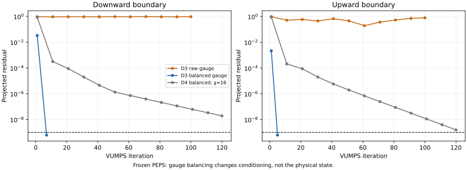
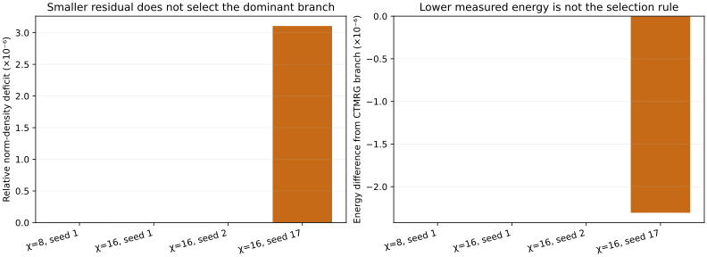
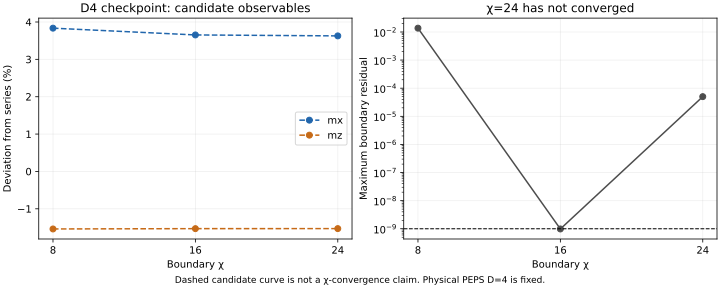

# 冻结态 boundary-VUMPS 核对：本地验证结果

## 1. 本轮结论

**VUMPS 加上保持物理态不变的 bond-gauge balancing，显著增强了 D=3 候选态的测量可信度；它没有把现有 D=4 checkpoint 变成通过 benchmark 的结果。**

1. 零场 exact control 给出 e=−1、全部 stabilizers=1、mₓ/m_z≈0，测量接口校准通过。
2. D=2 的冻结双分量态，VUMPS 与此前 CTMRG 一致。
3. D=3 的较大 norm 分支在 boundary χ=8/16 和 seeds 1/2 下一致；与此前合理 CTMRG 分支的能量差约 1.2×10⁻¹²、磁化差不超过 1.3×10⁻¹¹。因而约 0.77% 的 Z 磁化偏差主要属于候选态质量，而非这一 contraction 分支的测量错误。
4. D=3 的 seed17 找到邻近、较小 norm 的驻点分支，虽然 residual 更小、测得能量更低，也不因此被优先选取。这提示 VUMPS 仍需检查主导性。
5. D=4 在 χ=16 时可以达到设定的迭代 residual，但上下 norm estimates 仍有差别；χ=24 未收敛。不同 candidate 的非零磁化仍明显偏离参考，故**不能说换成 VUMPS 后 D=4 就通过了**。

全部任务在本地有界运行，没有使用或尝试登录集群。本轮不进行新的 physical PEPS optimization，所有判断针对上一轮保存的同一组 V、P、λ。

## 2. 冻结对象、边界与实现

物理设置沿用 H=−ΣA−ΣB−0.1ΣX−0.1ΣZ，Jₑ=Jₘ=1，Pauli operators，无限方格、2×2 vertex cell，physical d=2。主检查对象是 `d3-xz` 的 step900、τ=15.4，以及 `d4-xz` 的 step973、τ=16.665。后者上一轮未完成优化，不能期待换测量算法自动修复候选态。

另外使用解析零场 exact state 校准，用 D=2 双分量 checkpoint 检查与已有 CTMRG 的一致性。输入 checkpoint 的 SHA-256 被记录并核对，物理数据没有改动。

### 2.1 使用的 VUMPS 路线

- 将精确 blocked PEPS 形成 double-layer local tensor Q[n,e,s,w]，每条 fused virtual leg 的 dimension 为 D²。
- 用这些 Q 构造 MPSKit 的 dense row-transfer MPO，保留两行、两列的 unit cell。
- 向下传播与反方向的 adjoint transfer **分别求解** boundary MPS；没有把一般非 Hermitian transfer 当作 Hermitian Hamiltonian。
- 使用 MPSKit 0.13.12 的 multiline `leading_boundary(...,VUMPS(...))`，内部 eigensolver 设置 `ishermitian=false`。

PEPSKit 官方 boundary-MPS 文档明确提醒，多行和非 Hermitian 情况下 VUMPS 也可能不稳定。本轮没有假定其必然优于 CTMRG。

### 2.2 四体观测量怎样测量

主 boundary 求出后，构造夹在上/下 boundary MPS 之间的两行 strip。再独立求该 strip 在水平方向的主左右 transfer eigenvectors。

Star、plaquette 都跨两行、两列 composite sites，因此可在 strip 中插入完整的四体 operator。单点 X/Z 使用同一套 numerator/denominator contraction。上下边界、水平环境、算符插入和 norm 分母都保持相同坐标约定。

这里两个方向都是无限长度；**没有采用上一轮 circumference-4 的有限横向截断**。之前的圆柱结果仍保留为另一项有限周长诊断，但不是此次 VUMPS 数值的来源。

### 2.3 几种 residual 的含义

| 指标 | 检查对象 | 能否单独保证物理结果可靠？ |
|---|---|---|
| VUMPS projected/Galerkin residual | 固定 χ 的 boundary MPS 是否满足投影自洽条件 | 不能保证是主导分支或 χ 已足够 |
| Horizontal strip eigen residual | 在给定上下 boundary 后，左右水平环境是否求准 | 不能修复不准确的上下边界 |
| 上下 norm-density difference | 正反向 transfer 得到的 bulk norm estimates 是否相容 | 是有用的一致性指标，仍需 χ/初态检查 |
| Im⟨O⟩、operator bounds | Hermitian observables 的基本数值性质 | 必要但不充分 |

除 exact control 采用 tol=10⁻⁸ 外，主 boundary 的目标 tol=10⁻⁹。`converged_candidate` 只说明此次迭代/基本观测量检查通过，**不等于该分支已获最终物理验收**。

## 3. Gauge balancing：为什么允许做、实际改变了什么？

原先的 blocked tensor 将 boundary λ 完整放在某一个端点。测量前可将它平均分配到两个端点，即：

```text
某个 bond 一端：乘 λ^(−1/2)
另一个 bond 一端：乘 λ^(+1/2)
```

两端相乘为 identity。这是精确的 virtual gauge transformation，保持 wavefunction，保持 D，不是重新优化 physical state。之后每个 tensor 的整体归一化只改变 norm 的标度，不改变归一化观测量。

对实际 D=3、D=4 checkpoint 的 2×2 periodic wavefunction，balancing 前后相对差分别为 **6.24×10⁻¹⁶、1.26×10⁻¹⁵**。涉及的 √λ 最小/最大比约为 0.0292、0.171，未触发 pseudoinverse cutoff。对应记录见 [vumps_gauge_audit.json](vumps_gauge_audit.json)。此有限网络恒等式检查验证的是 gauge 实现，不是用小环面取代无限平面物理 benchmark。

影响非常明显：D=3、χ=8、seed1，原 gauge 的上下 VUMPS residual 在 100 轮后分别约 0.940、0.775，观测量还带有很大的虚部；balancing 后分别降到约 6.12×10⁻¹⁰、6.14×10⁻¹⁰，并恢复与可靠 CTMRG 分支一致的结果。



**图 1｜单纯“换成 VUMPS”不够，gauge 的数值条件也很重要。** 原 gauge 与 balanced gauge 的 physical PEPS 相同。图中的 D=4 χ=16 是最初 120 轮记录；之后另做 boundary continuation，未改 physical tensors。

不同 gauge 在局部归一化后产生的原始 norm 数字可能相差很大，不能直接跨 gauge 比大小。下面的 norm 分支比较全部在**相同 balanced gauge、相同 tensor 标度**下进行。

## 4. D=3：独立测量支持了此前候选态，但发现邻近分支

### 4.1 主要观测量

| 方法/设置 | e，每 edge spin | mₓ | m_z |
|---|---:|---:|---:|
| 前次 CTMRG，原 gauge，χ=12 | −1.005038775468 | 0.050833505425 | 0.050512355906 |
| VUMPS，balanced，χ=8，seed1 | −1.005038775469 | 0.050833505432 | 0.050512355943 |
| VUMPS，balanced，χ=16，seed1 | −1.005038775467 | 0.050833505426 | 0.050512355919 |
| VUMPS，balanced，χ=16，seed2 | −1.005038775467 | 0.050833505425 | 0.050512355919 |
| 十阶低场能量/九阶磁化参考 | −1.005044710610 | 0.050904160373 | 0.050904160373 |

χ=8→16、seed1→2 的变化都很小。与此前 CTMRG 的主候选分支相比，五个平均量 e、mₓ、m_z、⟨A⟩、⟨B⟩的最大差约 **1.25×10⁻¹¹**，见 [vumps_agreement.json](vumps_agreement.json)。

这使我们能更有把握地说：当前 D=3 态的 m_z 偏差约 −0.770%、mₓ偏差约 −0.139%、能量差约 +5.94×10⁻⁶/spin，是候选态的实际近似偏差。它不再仅依赖单一 CTMRG 求解路径。

但这仍不能区分该偏差来自有限 D ansatz，还是 loop/cluster update 未达到该 ansatz 内更好的态；同一 ansatz 的独立优化对照尚未完成。

### 4.2 Seed17：能量更低，却不是更优先的收缩分支

在 χ=16 下，seed17 也满足 projected residual，但得到：

```text
e = −1.005041081391
m_z = 0.050512232919
norm/cell ≈ 0.002107976150138
```

Seeds 1、2 的 norm/cell 则约为 **0.002107982698852**。Seed17 的 norm 增长因子相对小约 **3.11×10⁻⁶**，而其能量比主候选分支低约 2.31×10⁻⁶/spin。



**图 2｜分支选择不能采用“能量越低越好”。** 这里物理 tensors 没有变，目标是找到正确的主导 transfer boundary，而不是通过换环境优化基态能量。

我们优先报告 seeds1/2 所达到的、较大 norm 且对 χ 稳定的分支；seed17 原始记录完整保留。有限 χ、非 Hermitian 情况下，这一比较不是严格全谱主导性证明，但它比只看 residual 或挑较低能量有更直接的物理依据。另一分支对 m_z 的影响仅约 1.23×10⁻⁷，也远小于相对参考的约 3.92×10⁻⁴ 偏差。

### 4.3 Balanced CTMRG 的补充

将相同 balancing 也用于 CTMRG：χ=8 收敛到主分支，χ=12 收敛到与 seed17 VUMPS 一致的邻近分支，χ=16 仍发生不收敛。这说明邻近分支现象不只属于 VUMPS；也表明 balancing 改善数值条件，但不能消除所有环境问题。

本轮没有仅凭某一分支更接近文献就选择它。分支记录、norm 比较、χ 变化及算法间对照均被保留。

## 5. D=4：迭代可以收敛，但还没有完成可靠收缩

### 5.1 Boundary χ 检查

固定上一轮未收敛的 D=4 physical checkpoint，得到：

| χ_boundary | 最大 projected residual | e | mₓ | m_z | 判断 |
|---:|---:|---:|---:|---:|---|
| 8 | 1.37×10⁻² | −1.004879428776 | 0.052856381995 | 0.050120172982 | 向下 boundary 未收敛，且虚部过大 |
| 16，追加 boundary 迭代后 | 9.83×10⁻¹⁰ | −1.004863543349 | 0.052763999111 | 0.050124507392 | 投影迭代收敛，但 χ/systematic uncertainty 未解决 |
| 24，从 χ=16 boundary 扩大 | 5.01×10⁻⁵ | −1.004862532989 | 0.052751070355 | 0.050125044121 | 未收敛；只作 candidate 记录 |

χ=16 的两个随机初始边界给出几乎相同的观测量。不过 seed17 的向下 residual 在 200 轮后为 1.13×10⁻⁹，略未达到目标；没有事后放宽阈值把它改标为成功。

更重要的是，χ=16 的向下、向上 norm/cell 分别约为 3.99267630×10⁻⁵、3.99428145×10⁻⁵，相对差约 **4.02×10⁻⁴**。在 χ=24 时，这个差减小到约 2.92×10⁻⁵，但边界迭代尚未收敛。因此“χ=16 residual 达标”仍不足以宣称 contraction 已控制。



**图 3｜这里的虚线不是 χ-convergence curve 的验收声明。** 它连接的是收敛状态不同的 candidate，显示候选观测量仍明显偏离参考。

### 5.2 能否说 D=4 原来仅仅是 CTMRG 或超时问题？

不能。现在在本地已经让 χ=16 的 VUMPS 迭代达到目标 residual，其候选 mₓ仍约偏高 3.65%，m_z 约偏低 1.53%。Balanced CTMRG 的 χ=12/16 也给出了偏离参考的候选结果，例如 χ=16 的 mₓ≈0.05275158。

因此，没有观察到“保持同一个 D=4 checkpoint，只把测量换成 VUMPS，就恢复正确 benchmark”的现象。另一方面，χ=24 未收敛、上下 norm 不一致，以及原 physical optimization 只完成了短延续，意味着我们仍不能将这些百分比当成已经认证的 D=4 态总误差，更不能据此证明所有 D=4 loop update 都失败。

本轮明确区分了：

- **迭代轮数不足**：χ=16 通过追加 boundary 迭代已部分解决。
- **边界近似/主导性问题**：较大 χ 和正反向 norm 仍显示未解决的不确定性。
- **物理态质量问题**：冻结的 D=4 态此前就未完成优化，测量方法不会自动改进它。

## 6. 可信度、检查和计算成本

- 四项新的代码检查通过：column transfer 的独立直接求和、adjoint 恒等式、非均匀 λ 下的 gauge wavefunction 恒等式等，见 `vumps_tests.jl`。
- Exact control、D=2 与原 CTMRG 对照、D=3 多 χ/多初态对照，形成分层校准。
- 实际 D=3/D=4 checkpoints 的 gauge 恒等式和 SHA-256 核对通过。
- MPSKit 0.13.12、TensorKit 0.16.5、Julia 1.12.6，BLAS 单线程。D=3 单项（含首次编译和观测量）约 1 分钟；D=4 χ=24 的本次有界测试约 454 秒。
- boundary 求解设置的预算仅约束迭代阶段；观测量收缩与编译也占墙时，不能把 `--budget` 当作整个进程的严格 timeout。

“局部 projected residual 很小”与“已经得到正确的全无限网络主导环境”始终是两个不同断言。本报告没有把任何候选的低能量单独作为分支真实性证据。

## 7. 复现与数据

### 7.1 可移植冻结态

新增 [frozen_states/](frozen_states/) 中的三个紧凑 JSON snapshots，保存完整 V、P、λ、field、D、step、τ 和原 binary checkpoint hash。数值经过 JSON round-trip 检查；因此不必重新跑有时间中止的 physical optimization，也可以复现本轮冻结态核对。

`vumps_run.jl` 优先读取本地 `results/<state>/state.jls`；若不存在则读取 portable JSON。使用 `--portable=true` 可显式选择后者。边界 MPS checkpoint 属于生成数据，保存在各次 `results/vumps/<run>/` 下。

显式从 portable D=3 snapshot 运行 χ=16、seed2 的完整核对已完成，所得观测量与 binary checkpoint 路线逐数一致，记录后缀为 `-portable`。

### 7.2 核心命令

从 repository root：

```bash
# 解析 exact control
OPENBLAS_NUM_THREADS=1 julia -O1 --project=julia-env tracks/peps/solutions/anyon-correlator/simple-update/loop/vumps_run.jl --state=exact --chi=4

# D=3 主核对：可直接使用 portable snapshot
OPENBLAS_NUM_THREADS=1 julia -O1 --project=julia-env tracks/peps/solutions/anyon-correlator/simple-update/loop/vumps_run.jl --state=d3-xz --chi=16 --seed=2 --tol=1e-9 --maxiter=100 --balanced=true --portable=true --budget=300

# D=4 有界核对；达标与否由输出判断
OPENBLAS_NUM_THREADS=1 julia -O1 --project=julia-env tracks/peps/solutions/anyon-correlator/simple-update/loop/vumps_run.jl --state=d4-xz --chi=16 --seed=1 --tol=1e-9 --maxiter=200 --balanced=true --portable=true --budget=300

# 局部 contraction / gauge 检查
julia -O1 --project=julia-env tracks/peps/solutions/anyon-correlator/simple-update/loop/vumps_tests.jl
```

本次 χ=16 的历史流程是先运行 120 轮，再从边界 checkpoint 追加；χ=24 则从它扩大 boundary dimension。用 `--resume-boundaries=<boundaries.jls>` 和 `--tag=<suffix>` 可以保留追加计算的独立记录。扩大 boundary 时只改变初始边界猜测，physical tensors 仍被冻结。

全部原始 VUMPS 结果位于 `results/vumps/`，包括失败、未收敛和较小 norm 分支。摘要见 [vumps_summary.csv](vumps_summary.csv)，源码为 [vumps_core.jl](vumps_core.jl)、[vumps_run.jl](vumps_run.jl)。

```bash
# 使用已收集的完整结果重新生成表格和本报告图片
.venv/bin/python tracks/peps/solutions/anyon-correlator/simple-update/loop/vumps_analyze.py
```

脚本会核对结果引用的 physical checkpoint hash，并在摘要中保留失败标记。原始 `results/` 被仓库忽略；portable physical snapshots、摘要和 SVG 是可保存的研究记录。

## 8. 对后续方向的更新判断

当前最有价值的新结论不是“VUMPS 一定优于 CTMRG”，而是：

> **测量 gauge 和环境主导性是实质问题。通过独立上下 boundary-VUMPS、保持状态的 gauge balancing，以及 χ/初态比较，D=3 的合理 contraction 分支得到了独立支持；它的剩余 benchmark 偏差应主要转向 ansatz/update 质量去研究。D=4 仍需要更充分的边界和物理优化验证。**

本轮没有消耗远程资源。更长的 D=4 或更大 χ 验证可在之后有课题组资源时继续；单纯增加算力仍不能替代分支选择与收敛判据。

### 方法依据

- [PEPSKit：Boundary MPS contractions of 2D networks](https://quantumkithub.github.io/PEPSKit.jl/stable/examples/boundary_mps/)：multiline transfer、VUMPS，以及非 Hermitian/多行可能不稳定的说明。
- [MPSKit 文档](https://quantumkithub.github.io/MPSKit.jl/stable/)：VUMPS、multiline MPS、非 Hermitian fixed-point 求解。实现同时核查了本地 0.13.12 源码。
- [Zauner-Stauber et al., PRB 97, 045145 (2018)](https://doi.org/10.1103/PhysRevB.97.045145)：VUMPS 方法基础；本文使用的是其 boundary-transfer 应用，而非直接求二维 Hamiltonian 的一维基态。
