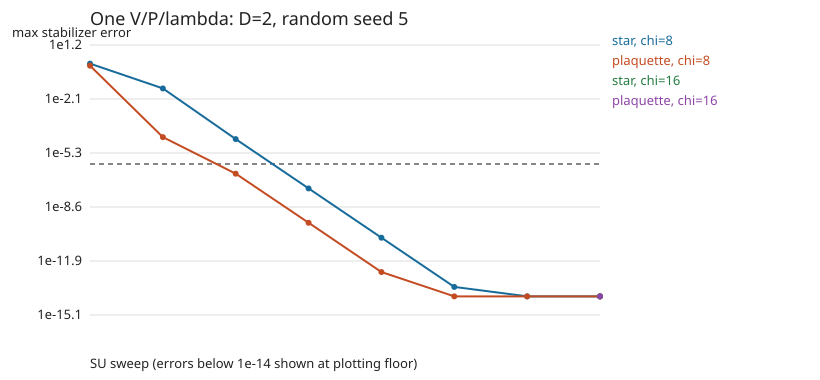
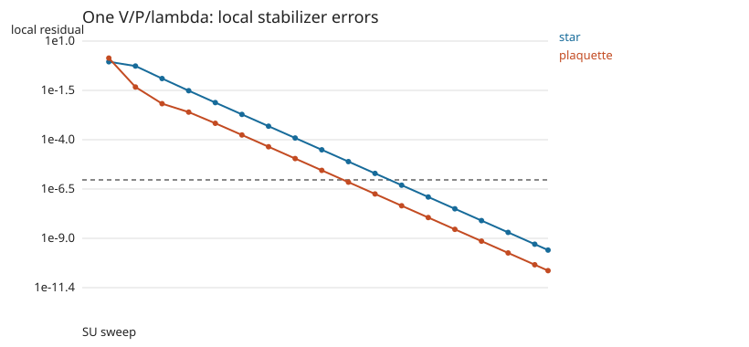

# 单组 V/P/λ 的零场计算结果

**$D=2$、随机 seed=5，700轮后测得每边自旋能量 $e=-1$，$\chi=8,16$ 的最大稳定子偏差均约为 $4.44\times10^{-16}$，满足本轮 $10^{-6}$ 的精度判据。** 全程更新一组 $V/P/\lambda$，并在每次局部门更新结束后保持1-site平移不变性、$V$ 的90°旋转关系和 $P$ 的端点交换关系。

## 计算设置

模型为 $H=-\sum_s A_s-\sum_p B_p$，采用 Pauli convention，$J_e=J_m=1$。自旋 $1/2$ 位于无限平方晶格的边上，物理维数 $d=2$、虚拟维数 $D=2$。每个顶点采用同一个 $V$，每条横边、竖边采用同一个 $P$，每条 $V$—$P$ 连接采用同一个 $\lambda$；$V,P$ 分别满足循环旋转和端点交换关系，本次未额外施加虚拟 $\mathbb Z_2$ 对称约束。

初态为 seed=5 的正态随机 $V,P$，经空间对称投影和归一化后配以 $\lambda=(1/\sqrt2,1/\sqrt2)$，初始能量约为 $+0.01610$。完整计算从该随机初态开始，固定门步长 $\tau=0.05$，共700轮；每轮依次完成 star 高阶 SVD 更新和 plaquette 闭环交替最小二乘更新，后者每次最多迭代12轮。每次局部更新后立即恢复一组共享参数。

末态用 $\chi=8,16$ 的 CTMRG 环境分别测量。环境收敛容差为 $10^{-10}$，最大迭代次数400。算法的局部度量、截断方式和共享参数恢复见 [README.md](README.md)。

## 能量、稳定子与局部张量检查

零场基态是全部稳定子的共同 $+1$ 本征态。测量时把一组 $V/P/\lambda$ 复制到 $2\times2$ 重复单元，以无限环境计算其中各个 star、plaquette 的期望值。该单元包含8个边自旋，因此按边自旋归一化的能量为

$$
e=-\frac18\left(\sum_s\langle A_s\rangle+\sum_p\langle B_p\rangle\right).
$$

这里两项求和分别覆盖单元中的4个 star 和4个 plaquette。定义最大稳定子偏差 $\delta_{\mathrm{stab}}$ 为这些位置上所有 $\lvert\langle A_s\rangle-1\rvert$、$\lvert\langle B_p\rangle-1\rvert$ 的最大值。

| 测量 | $\chi=8$ | $\chi=16$ |
|---|---:|---:|
| 每边自旋能量 $e$ | $-1.000000000000$ | $-1.000000000000$ |
| 最大稳定子偏差 $\delta_{\mathrm{stab}}$ | $4.44\times10^{-16}$ | $4.44\times10^{-16}$ |
| CTMRG环境收敛误差 | $4.44\times10^{-16}$ | $4.44\times10^{-16}$ |
| 环境是否收敛 | 是 | 是 |

两种 $\chi$ 测得的能量一致，$\delta_{\mathrm{stab}}$ 均小于 $10^{-6}$。下图显示 $\chi=8$ 的稳定子偏差随更新轮数下降，以及末态 $\chi=16$ 的复测结果。图中低于 $10^{-14}$ 的值显示在绘图下限，原始数值保留在逐轮记录中。

为了检查稳定子与局部张量本身的关系，还构造了保留全部外接虚拟指标的 star 张量 $\Theta_s^{(0)}$ 和 plaquette 张量 $\Theta_p^{(0)}$。上标 $(0)$ 表示外接腿不乘环境近似所用的 $\lambda$，区域内部的连接权重仍保留。分别计算

$$
r_A=\max_s\frac{\|(A_s-I)\Theta_s^{(0)}\|_F}{\|\Theta_s^{(0)}\|_F},\qquad
r_B=\max_p\frac{\|(B_p-I)\Theta_p^{(0)}\|_F}{\|\Theta_p^{(0)}\|_F},
$$

其中范数对全部物理和未收缩虚拟指标取 Frobenius 范数，最大值在重复单元内各位置上取。最终得到 $r_A\approx2.86\times10^{-10}$、$r_B\approx2.62\times10^{-11}$，其下降过程如下。

这组残差衡量开放外接虚拟指标时的张量恒等式偏差；$\delta_{\mathrm{stab}}$ 则来自无限环境收缩后的物理期望值。二者检查不同对象。接近机器精度的是表中期望值相对目标的偏差，末态局部张量仍有上述有限残差。

700轮共包含1400次局部门更新。对每次恢复后的归一化张量检查 $\|V-RV\|_F$、$\|P-SP\|_F$，最大值均为0；$R,S$ 分别是 README 中定义的90°循环旋转和端点交换。共享参数恢复过程中，在张量取平均之前，成对变基及连接权重重写前后的归一化局部张量差 $\epsilon_{\mathrm{gauge}}$ 最大约为 $5.20\times10^{-13}$。

张量更新累计约10.70秒。整个进程含导入、首次编译和测量约173秒，峰值内存约2.19GiB，使用本地单线程。

## 随机起点比较

在选择完整计算的起点前，对六个随机seed各试跑了320轮。下表列出其局部张量残差，定义与上文相同。

| seed | 320轮后的 $r_A$ | 320轮后的 $r_B$ |
|---:|---:|---:|
| 1 | $6.47\times10^{-7}$ | $1.4141$ |
| 2 | $9.44\times10^{-2}$ | $1.4142$ |
| 3 | $2.35\times10^{-4}$ | $1.4142$ |
| 4 | $7.88\times10^{-14}$ | $1.4142$ |
| 5 | $1.30\times10^{-4}$ | $1.19\times10^{-5}$ |
| 6 | $7.68\times10^{-2}$ | $1.4134$ |

试跑以 $\max(r_A,r_B)<10^{-5}$ 为停止条件，320轮时六个起点均未达到此条件。其中seed=5的两类残差持续下降，因此选它从随机初态重新进行700轮完整计算。

六起点试跑早于 $P$ 的虚拟基底选择修正；该修正增加了对保持 $P$ 不变的反射变换的检查，并利用相邻 $V$ 选择表示。最终程序完成700轮和 $\chi=8,16$ 测量的起点只有seed=5。因此，这组试跑能够说明当时版本的初态依赖性，最终版本的多起点同预算比较仍待完成。

## 结果范围与局限

能量、全部稳定子期望值、两个 $\chi$ 的环境收敛以及局部张量残差，共同支持 seed=5 在设定精度下得到数值零场基态。表中 $10^{-16}$ 量级的期望值偏差和 CTMRG 收敛误差，是浮点计算与有限环境下的诊断值，并不直接给出物理态误差的严格界限。

每次更新后的共享参数均满足规定的张量对称关系。算法的收敛还取决于局部环境近似、固定 $D$ 的截断和闭环拟合，以及随后张量取平均的效果。其中 $\eta_{\mathrm{plaq}}$ 在恢复共享参数前计算，$\epsilon_{\mathrm{gauge}}$ 只覆盖成对变基和权重重写；各位置张量取平均造成的变化尚未单独量化。当前完整结果仍是一个随机起点的成功算例，多起点可靠收敛是尚未完成的问题。

## 数据与复现

- 运行命令与方法说明：[README.md](README.md)。
- 当前完整记录：[`results/strict-zero-seed5-v2/`](results/strict-zero-seed5-v2/)，包含初态、逐轮数据、最终张量、测量、参数和当次源程序副本。
- 可移植的最终张量：[`frozen_states/strict-zero-seed5.json`](frozen_states/strict-zero-seed5.json)，与完整记录中的 `final.json` 一致，Julia二进制末态一并保留。
- 六起点试跑：[`results/strict-pilot-v1/`](results/strict-pilot-v1/)。

已有软件检查记录为专项测试49/49通过、完整项目Julia回归388/388通过，对应日志为 `strict-tests.log` 和 `strict-full-tests-v2.log`。
