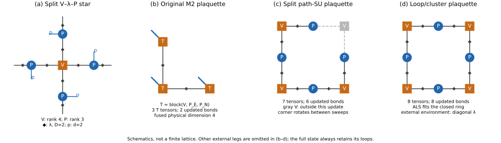
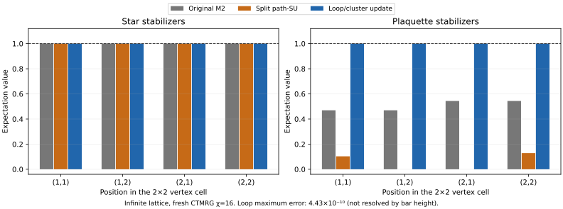

# Toric code 零场基态：D=2、d=2 tensor network 的独立 update 审查

本文记录零场实验，有限场结果见 [../loop/REPORT.md](../loop/REPORT.md)，旧 SU 停滞原因另见 [专题研究](../../research/su-stagnation/README.md)。

> **报告目的**：从 tensor setup 和更新规则出发，解释原 M2、独立 path-SU、loop/cluster update 三种计算的具体区别，记录它们的随机初始化结果，并界定这些结果对“SU 算法局限还是原代码错误”这一问题能够支持的结论。
>
> **范围**：hₓ=h_z=0、无限方格、D=2；主实验使用随机初始化，唯一的物理对照为 exact state。本文同时包含实际运行结果、数学解释和未运行的改进建议，三者明确区分。新增图片由已有数据或网络结构生成，没有为撰写本报告增加新的物理计算。

## 阅读路线

1. [物理模型与 tensor setup](#sec-setup)
2. [SU 的共同思想：gate、环境和截断](#sec-common)
3. [原 M2：merged-PEPS SU](#sec-m2)
4. [新实现共用的 star update](#sec-star)
5. [新 path-SU：七张量路径更新](#sec-path)
6. [新 loop/cluster update：ALS 与 λ 重建](#sec-loop)
7. [三种方法究竟有哪些相同和不同](#sec-comparison)
8. [运行设置、观测量与验收标准](#sec-protocol)
9. [数值结果和 exact-state 对照](#sec-results)
10. [讨论：blocking、四方向更新与算法可信度](#sec-discussion)
11. [结论与仍未解决的问题](#sec-conclusion)
12. [代码、数据、复现命令和文献](#sec-artifacts)

<a id="sec-setup"></a>
## 1. 物理模型与 tensor setup

### 1.1 Hamiltonian、晶格与能量归一化

采用与原 M2 相同的约定：

```text
H = −Σₛ Aₛ −Σₚ Bₚ
Aₛ = ∏_{i∈star s} Xᵢ
Bₚ = ∏_{i∈plaquette p} Zᵢ
Jₑ = Jₘ = 1，hₓ = h_z = 0
```

X、Z 为 Pauli matrices，而不是含 1/2 因子的 spin operators。每条方格边承载一个 spin-½，因此单个物理自由度的 dimension 为 d=2。

所有 stabilizers 相互对易，且 Aₛ²=Bₚ²=I。基态可以同时满足所有 ⟨Aₛ⟩=⟨Bₚ⟩=1。每个 vertex 对应两个 edge spins、一个 star term 和一个 plaquette term，所以：

```text
每 edge spin：e₀ = −1
每 vertex/composite site：E₀ = −2
2×2 vertex unit cell：8 个 edge spins，E₀,cell = −8
```

主计算是**无限二维网络**。2×2 指的是重复的 tensor unit cell，不是将主系统限制在一个八自旋小环面。后文的 2×2 periodic contraction 是另外的有限系统诊断。

本次不预选 global topological sector，也不计算 Wilson loops 或 anyon sectors；验收对象是零场能量和所有局部 stabilizers。

### 1.2 用户指定的 split V–λ–P 网络

新实现始终保留以下结构：

| 对象 | 所在位置 | 指标 | 本次 shape |
|---|---|---|---|
| Simplex tensor V | 每个 vertex | N、E、S、W 四条 virtual legs | (2,2,2,2) |
| Projection tensor P | 每条 edge | physical、tail virtual、head virtual | (2,2,2) |
| Bond tensor λ | 每个 V–P 连接 | 非负 diagonal weight | 长度 2 |

每条原始 lattice edge 上有一个 P，以及位于它两端的两条 V–P connections，**每个 connection 各有一个 λ**。2×2 vertex cell 因而包含 4 个 V、8 个 P、16 个 λ。

图中用方形表示 V 或融合后的 T，圆形表示 P，菱形表示 λ。



**图 1｜局部结构示意。** (a) split network 中一个 star 的五张量 cluster；(b) 原 M2 在三个 merged T 上做 L-shaped update；(c) path-SU 将一个 corner V 留在当前更新区域之外，保留七张量路径；(d) loop/cluster update 保留完整八张量环。(b–d) 为清晰起见省略了其他外腿。灰色 V 仍存在于完整物理态中，不是从网络删除；(c) 只展示轮换方向中的一种。

代码中的 V 轴顺序是 `[N,E,S,W]`，P 轴顺序是 `[physical,tail,head]`。E(r,c) 从 vertex (r,c) 指向 (r,c+1)，N(r,c) 指向 (r−1,c)，即 row index 向下增加。

“Projection tensor”在这里是网络构件名称；随机 P 的数值不被强制为解析 copy tensor，也不被强制为 isometry。新随机计算使用 dense real tensors，不施加 virtual-Z₂ constraint。

### 1.3 原 M2 的 merged tensor

原 M2 从同类 V、P 构造出发，把一个 vertex 与其 outgoing east/north projections 合并为 T。为简化公式，先将涉及的 λ 精确吸收到相应 P 中，记为 P̃：

```text
T[pE,pN,n,e,s,w]
  = Σa,b V[b,a,s,w] P̃_E[pE,a,e] P̃_N[pN,b,n]
```

再融合 pE、pN，得到 shape `(4,2,2,2,2)` 的 PEPS tensor。d=4 表示两个 d=2 自旋合并，不是改变了物理模型。

**初始 blocking 是精确收缩，不引入误差。** 但后续原 SU 直接更新一般的 T，不再要求它能够以所有内部 V–P bonds 均为 D=2 的形式拆回去。这是后续两种 ansatz 不等价的关键。

例如，将 T 看成以 `(pE,e)` 为行、其他指标为列的矩阵：split 构造仅通过 a 相连，所以该矩阵 rank≤2；一般的 merged T 则可以有 rank=4。因此：

> 同一个 split state 可以精确表示为 merged state；反过来，一个更新后的任意 merged T，不保证能精确拆回内部 D=2 的指定 V–P 网络。

这说明原 merged ansatz 一般更宽，不能把它的失败解释为表达能力比新 split ansatz 更弱。

### 1.4 随机初始化：共同构造思想与不同数值初态

| 初始化细节 | 原 M2 replay | 新 path-SU 与新 loop update |
|---|---|---|
| 基本构造 | 随机 V、P_E、P_N | 随机 V、P |
| 空间分布 | 一组 V、P_E、P_N 融合后复制到四个位置 | 每个位置分别生成随机 V、P |
| RNG | `Random.seed!(1)` 的原始生成流程 | `MersenneTwister(1)` |
| 初始 weights | Composite bonds 的单位 weights | 每个 V–P connection 的 λ=(1,1) |
| 后续是否强制所有位置相同 | 不强制 | 不强制 |

两者都属于“从随机 V、P 出发”的初始化方案，但**本次实际使用的初始物理态不同**。空间独立初始化是新实验的选择，不是 split representation 的必然要求。新 path-SU 和新 loop update 则使用**逐元素完全相同的初始 V、P、λ**。

### 1.5 唯一物理对照：exact state

exact control 使用以下 D=2 张量，指标取 0、1：

```text
V[n,e,s,w] = δ(n⊕e⊕s⊕w,0)
P[p,a,b] = δ(a,b) (−1)^(p a) / √2
λ = (1,1)
```

P 在 X basis 中复制 virtual occupancy，而 physical index 用 Z basis 表示。实现会分别归一化局部张量，这只改变整体态的标度。该构造在本 Hamiltonian 约定下满足 star 和 plaquette 的 +1 条件。

Exact state 只用于对照；随机轨迹没有用它初始化、重启或修补。没有另外设置 product-state 或 staged-SU 物理对照。

<a id="sec-common"></a>
## 2. SU 的共同思想：gate、环境和截断

### 2.1 三种方法施加相同的精确 gate

由于 stabilizer O 满足 O²=I：

```text
exp(dt O) = cosh(dt) I + sinh(dt) O
G_A(dt) = cosh(dt) I + sinh(dt) X⊗4
G_B(dt) = cosh(dt) I + sinh(dt) Z⊗4
```

每个完整 sweep 遍历四个 vertex，并在各位置交替施加 star 和 plaquette gate，总计四个 star、四个 plaquette gates。

在零场时所有 Hamiltonian terms 对易，**若没有近似压缩，门序本身不产生 Trotter error**。实际算法中的顺序和 dt 仍然可能影响结果，因为每次 gate 后都进行了非线性的有限 D 压缩及 weights 更新。

### 2.2 近似发生在哪里？

Gate 会把局部态带出当前有限 D 表示所能精确容纳的集合。更新算法必须决定怎样把它近似回目标网络。这个决定至少包含两个部分：

1. **误差用什么环境度量？** 是精确外环境、CTMRG 环境，还是 independent diagonal λ？
2. **在该度量下怎样找近似态？** 是 bond SVD、TT-SVD、HOSVD，还是多张量 ALS？

本次三种方法更新时都不调用 CTMRG；CTMRG 只测量。Loop 方法虽然仍以 diagonal λ 近似外环境，却保留了完整 plaquette 内部关联，所以明确称为 **loop/cluster update**，不将它等同于普通 path-SVD SU，也不称为 full update。

### 2.3 显式 λ 与已吸收 λ 的约定

新实现存储 Γ–λ 形式：V、P 是 site tensors，每个物理网络 connection 上的 λ 只出现一次。构造局部更新 cluster 时，外腿额外吸收 λ，用它定义 simple-environment metric；分解后移除这些外部权重。

若 bare cluster 为 Θ，外部权重构成乘积映射 W，则局部拟合用的是 `‖W(Θ_new−Θ_target)‖²`。代码先吸收 W，因此后续对加权张量直接使用 Frobenius norm，不能再次重复加权。

原 PEPSKit 的 state tensors 已经部分吸收了 bond weights，因此其更新例程在 open legs 上吸收/移除的是 **√λ**。这与显式 Γ–λ 实现使用完整 λ 并不矛盾。审查 weights 时应比较完整重构的物理态，不能看到 √λ 与 λ 不同就判定有 bug。

<a id="sec-m2"></a>
## 3. 原 M2：merged-PEPS SU

### 3.1 Star 和 plaquette 都是三个 T 的 L-shaped update

对 star，涉及的 composite sites 是：

```text
T(r,c−1) — T(r,c)
               |
            T(r+1,c)
```

四个 X 分别作用在左侧 T 的 E 自旋、中心 T 的 E/N 两个自旋、下方 T 的 N 自旋上。

对 plaquette，涉及的 composite sites 是：

```text
T(r−1,c)
    |
 T(r,c) — T(r,c+1)
```

对应四个 Z 分别作用在上方 T 的 E 自旋、中心 T 的 E/N 自旋、右侧 T 的 N 自旋上。每个 cluster 包含三个 T、六个物理自旋；gate 只作用其中四个，其余两个上作用 identity。

### 3.2 实际压缩流程

原代码将精确三站点 gate 转为 MPO，调用 PEPSKit 的 `su_iter`。库中通过路径的左右 QR/LQ 因子构造各 bond 的截断投影，再更新三个 T 和两条内部 composite bond weights。这是库的多 bond 投影流程，不是本次新写的 sequential TT-SVD，也不是四臂 HOSVD。

`final_audit.jl` 中的 `LegacyReplay` 原样引用原 `tc_peps.jl` 来重跑该计算；新 SU 核心和新测量代码不引用它。

### 3.3 原方法的停止条件

原 replay 使用 dt=0.05，每 25 sweeps 与上一次保存的 weights 比较，差异小于 10⁻¹⁰ 时停止。它在第 175 sweep 达到这一条件。

这个判据仅表示 **weights 稳定**，不要求能量或 stabilizers 达到基态值，也不能直接视为 variational energy stationarity。

<a id="sec-star"></a>
## 4. 两种新方法共用的 star update：四臂 HOSVD

新方法直接在一个 V 和四个相邻 P 构成的树形 cluster 上更新，如图 1(a)。具体步骤为：

1. 收缩中心 V、四个 P、内部 λ，并在四条外部 virtual legs 上吸收对应 λ。
2. 每个 P 留下一个 physical index p 和一个 external virtual index b；把 `(p,b)` 作为一个四维分组。
3. 得到四个分组组成的局部张量，大小为 4⁴=256。
4. 在四个 physical indices 上施加 G_A(dt)。
5. 分别对四个方向的 unfolding 做 SVD，各保留两个左奇异向量，形成四臂 HOSVD。
6. 将目标张量投影到四个保留子空间中，得到新的中心 core；恢复四个 P 和四条 λ，移除外部权重并归一化。

这里的四个 SVD 是同一个多方向 HOSVD 构造的组成部分，不是声称进行了四次全局最优截断。多方向 HOSVD 也不保证求出该树形网络的最优低 rank 拟合。

**新 path-SU 和新 loop update 调用完全相同的 `star_update!`。** 但它们的 plaquette 更新不同，所以随后的 V、P、λ 不同，下一次 star 更新的输入和输出自然不同。“star 规则相同”不意味着两条轨迹中的 star 数值更新始终一样。

<a id="sec-path"></a>
## 5. 新 path-SU：七张量 plaquette 路径

### 5.1 从完整环选取 open path

完整 plaquette 含四个 V、四个 P。Path-SU 将其中一个 corner V 留在当前 update cluster 之外，选取：

```text
P₁ — V₂ — P₂ — V₃ — P₃ — V₄ — P₄
```

这条路径包含四个物理自旋和六条内部 V–P bonds。遗漏的 V 仍在完整网络中；其连接两个路径端点的作用，在当前局部度量里由独立的外部 λ 代替。

因此，准确的表述是“**更新区域不包含这个 V**”，不是“断开或删除物理态中的这个 V”。每个 sweep 选择一个遗漏 corner，并在后续 sweeps 中循环轮换四种方向。

### 5.2 TT-SVD 与 λ 恢复

1. 将路径内部的 λ 各吸收一次，外部 λ 吸收到 open virtual legs。
2. 收缩七个张量，并施加相同的 G_B(dt)。局部目标有 4096 个标量元素。
3. 用 sequential TT-SVD 沿路径依次分解，六条内部 bonds 保留 D=2。
4. 对得到的 open-chain MPS 再做 right-canonical sweep，提取显式 Γ 和 λ。
5. 恢复每个 tensor 的原始指标顺序，移除外部 λ，把七个更新后的张量放回完整网络。

Sequential TT-SVD 是一组依次执行的局部低 rank 近似，不保证整体 fixed-rank TT 的全局最优性。路径截断误差也不等于完整二维物理态的误差，因为后者还包含路径两端经外部网络返回的关联。

<a id="sec-loop"></a>
## 6. 新 loop/cluster update：八张量 ALS 与 λ 重建

### 6.1 先区分“物理更新”和“恢复 Γ–λ 表示”

该方法分为两步：

```text
gate 后的局部目标 → ALS 改变八个张量以拟合目标
拟合后的八个张量 → regauging，恢复显式 V–λ–P 表示
```

第一步决定新的近似物理态；第二步在不改变该态的前提下，重新分配 site tensors 与内部 λ 的表示。后一项在无舍弃、可逆条件下是 gauge transformation，不是第二次 imaginary-time evolution。

### 6.2 加权环张量与目标

保留完整的 `V₁–P₁–V₂–P₂–V₃–P₃–V₄–P₄–V₁`。外部 λ 在本次局部优化期间固定；内部旧 λ 先吸收到相邻张量中，得到八个临时张量 G₁,…,G₈。

将每个 G 写成 `[left,q,right]` 的 rank-3 形式：对 P，q 是 dimension 2 的 physical index；对 V，q 是两条外部 virtual legs 合并而成的 dimension 4 分组，**不表示 V 新增了真实 physical spin**。

收缩闭环得到 Θ，其大小是 4⁴×2⁴=4096。施加 G_B(dt)，并归一化目标：

```text
Θ_target = G_B(dt) Θ / ‖G_B(dt) Θ‖
minimize ‖Contract(G₁,…,G₈) − Θ_target‖²
```

这个目标已经吸收 diagonal 外环境权重。它是 local weighted-cluster distance，不是全无限系统的精确 state distance，也不是直接最小化 ⟨H⟩。

### 6.3 ALS 为什么可行？

ALS 是 alternating least squares。固定七个张量后，整个收缩对第八个张量是线性的。将待优化 Gᵢ 展开为向量 xᵢ，其他七个张量定义线性映射 Kᵢ：

```text
vec(Θ_fit) = Kᵢ xᵢ
b = vec(Θ_target)
xᵢ,new = argmin_x ‖Kᵢ x − b‖²
```

代码通过 Kᵢ 的 SVD 求 pseudoinverse，再将解还原为 Gᵢ。依次更新 **V₁、P₁、V₂、P₂、V₃、P₃、V₄、P₄ 全部八个张量**，并循环。不是只拟合 V，也不是让 P 保持不变。

本次最多做 12 轮 ALS，求解器奇异值相对 cutoff 为 10⁻¹²。每个子问题在精确求解时不会增加当前局部目标，但整体多张量问题非凸，不保证全局最优；cutoff 和舍入误差也需与理想数学结论区分。达到轮数上限并不等于证明 ALS 已达到全局或局部最优点。

### 6.4 ALS 与 SVD/HOSVD 的关系

| 方法 | 数学作用 | 不应混淆的地方 |
|---|---|---|
| 单次 truncated SVD | 给定矩阵的最优指定-rank Frobenius 近似 | 最优性依赖所选矩阵和度量 |
| Sequential SVD | 沿路径连续选择低 rank 分解 | 不等于整个多 bond 拟合的全局最优解 |
| HOSVD | 为多个方向选取保留子空间 | 不是一般多张量优化的精确解 |
| ALS | 交替解线性子问题，迭代减小整体拟合残差 | 非凸、依赖初始化与条件数；每个子问题也可用 SVD 求解 |

所以“用 ALS 作 update”并不是不使用 SVD，而是让 SVD 服务于最小二乘求解，而非直接作为每条网络 bond 的截断规则。

### 6.5 λ 在拟合时没有被冻结

ALS 期间内部 λ 已吸收进 G。虽然没有把 λ 作为独立变量单独求解，但其所携带的自由度可以随 G 一起变化。拟合结束后再恢复显式 λ。

这时闭环没有 open MPS 那样简单的逐 bond Schmidt decomposition，因而采用 cavity-message/BP regauging。BP 即 belief propagation，此处仅在加权的八张量环上构造近似 gauge，不是对整个二维 iPEPS 求精确环境。

### 6.6 Cavity messages 是什么？

每条内部 bond 两侧分别维护一个 D×D 正半定矩阵 L、R，近似描述两侧 virtual basis 的范数/重叠度量。将局部 G 的开放分组写为 q，传播的基本形式为：

```text
L_new ∝ Σ_q G(q)† L_old G(q)
R_new ∝ Σ_q G(q) R_old G(q)†
```

从单位矩阵出发，沿两个方向迭代并归一化 trace。本次最多 200 轮，消息变化容差为 10⁻¹¹。**当前实现未保存每一次 regauging 的 BP 收敛标志，因此不能声称所有中间 λ 都已达到充分收敛的 quasi-canonical gauge。**

这些 messages 不是精确二维 reduced density matrices，也不是通过 CTMRG 得到的环境。

### 6.7 从 messages 提取 λ，并证明状态保持

对某条 bond 令 X=√L、Y=√R，做 D×D 矩阵 SVD：

```text
X Y = U Σ V†
```

Σ 的非负对角元给出新 λ。必须同时改变两侧张量，而不是只把新的 λ 填回旧网络。将已经吸收旧 weights 的相邻张量写成矩阵乘积 T_L T_R：

```text
T_L′ = T_L X⁻¹ U
λ′   = Σ
T_R′ = V† Y⁻¹ T_R

T_L′ λ′ T_R′
  = T_L X⁻¹ (U Σ V†) Y⁻¹ T_R
  = T_L T_R
```

在可逆且未丢弃非零方向时，这个恒等式保证纯 gauge 变换。随后分别归一化 λ 和 site tensors，只改变整体标度。实际计算采用相对 cutoff 10⁻¹⁴ 的谱处理/pseudoinverse；若出现近零方向，应根据实际支撑空间理解等式，不能忽略可能的数值舍弃。现有测试检查了闭环重构的状态保持。

**BP 对环境的近似与 gauge 变换的代数状态保持是不同问题。** 即使选取的 messages 不是精确外环境，只要上述变换可逆且完整配对，它仍可保持物理态；messages 的质量则影响新的 λ 是否是有用的近似环境权重，以及下一次 SU 的表现。

在有 loop 的网络中，λ 不是整个无限二维态的精确 Schmidt spectrum。保留全部 D 个奇异值的 regauging 也不应与 gate 后的物理压缩混为一谈。

### 6.8 文献依据与本实现的定位

ALS 用于 PEPS gate 后拟合是成熟方法：Phien 等 [1] 的 §II.2.3 给出了固定一个 tensor、优化另一个、交替求解的 full-update 流程。该文使用更完整的环境，本实现使用局部 diagonal 外环境，二者不等同。

Closed tensor-ring 的 ALS 拟合也有直接依据：Zhao 等 [2] 同时讨论 sequential SVD、ALS 和 block-wise ALS。BP messages、平方根、SVD 与 Γ–λ gauge 的关系见 Tindall–Fishman [3] §2.3–2.4。PEPS 局部优化的数值条件与 gauge 改善还可参考 Lubasch 等 [4]。

这些文献支持**算法组成部分**，并不意味着“四臂 HOSVD＋八张量 ALS＋局部 ring BP regauging”是逐行复现某篇已发表的 toric-code 算法。本报告将其定位为：**有标准数学依据、在本次零场单 seed 问题上得到验证的独立 local loop-update 实现**，而非已被广泛 benchmark 的标准 SU 软件。

<a id="sec-comparison"></a>
## 7. 三种方法究竟有哪些相同和不同？

| 项目 | 原 M2 merged-SU | 新 path-SU | 新 loop/cluster update |
|---|---|---|---|
| Hamiltonian、真实 edge spin d | 相同，d=2 | 相同 | 相同 |
| 更新变量 | 一般 merged T，fused d=4 | V、P(d=2)、显式 λ | 与新 path-SU 相同 |
| 固定 D=2 的连接 | Composite PEPS bonds | 所有 V–P bonds | 所有 V–P bonds |
| 实际随机初态 | 空间重复的一组 V/P | 每位置独立随机 | 与新 path-SU 完全相同 |
| Star cluster | 3 个 T，L-shaped | 1 V＋4 P，四臂树 | 同一个四臂树 |
| Star 压缩 | PEPSKit 多 bond 投影 | 四臂 HOSVD | 同一 HOSVD 函数 |
| Plaquette cluster | 3 个 T，L-shaped | 3 V＋4 P，open path | 4 V＋4 P，closed ring |
| Plaquette 内部更新 bonds | 2 | 6 | 8 |
| Plaquette 压缩 | Path-MPO＋库的截断投影 | TT-SVD | ALS |
| Plaquette λ/gauge | 库的 SU convention | Open-chain canonicalization | Ring BP regauging |
| 更新时是否用 CTMRG | 否 | 否 | 否 |
| 最终观测 | 新测量接口重收缩 | 同一接口 | 同一接口 |

因此应分两层阅读比较：

- **原 M2 对新方法**：不仅 plaquette update 不同，还同时涉及初态、ansatz、star update、cluster 边界及 weights convention。这不是等价算法的严格对照实现。
- **新 path-SU 对新 loop update**：初始数组、网络结构、star 规则、物理 gates 和初始 dt 相同；替换的是整个 plaquette-update prescription，包括 cluster、压缩和内部 λ/gauge。后续轨迹因此不同。

能定位到“plaquette 更新方案很重要”，但不能由此唯一归因于“补回一个 corner V”、ALS 求解器或 BP gauge 中的某一个因素。

<a id="sec-protocol"></a>
## 8. 运行设置、观测量与验收标准

### 8.1 时间步与运行长度

| 运行 | 计划 dt schedule | 实际终点 |
|---|---|---|
| 原 M2 replay | dt=0.05，最多 600 sweeps | 第 175 sweep 达到 weights 停止条件，τ=8.75 |
| 新随机 path-SU | 0.05×200；0.01×200；0.002×200 | 第 600 sweep，τ=12.4 |
| 新随机 loop update | 同上 | 第 120 sweep 满足观测量提前停止条件，τ=6 |
| 两种新方法的 exact control | dt=0.05 | 各 8 sweeps，τ=0.4 |

Path 数据的前 40 sweeps 保存在 `results/pilot/`，之后从该 checkpoint 继续到 600，保存于 `results/path-seed1/`。Loop 随机计算是从同一组原始随机数组重新开始，不是从 path 终点继续。

### 8.2 Infinite-lattice 测量

为调用 PEPSKit CTMRG，仅在测量时精确融合每个 V 与 outgoing E/N projections。融合过程中每条 λ 包含一次。这个测量接口不增加 SU 的 variational freedom，也不把更新改回 d=4。

独立构造四个 star 和四个 plaquette operators，测量次序为：

```text
A11, B11, A12, B12, A21, B21, A22, B22
e = −Σ(stabilizer expectations)/8
```

CTMRG 使用 fresh environment，tol=10⁻⁹、maxiter=250；轨迹测量 χ=8，最终对同一个冻结 tensor state 测 χ=8、16。默认 environment seed=2026；最终审查中仅在 contraction 不收敛或超出所设物理界容差时追加 seed=17。

### 8.3 验收与停止不是同一概念

物理验收要求能量每自旋接近 −1、每个 stabilizer 接近 +1，误差均在 10⁻⁶ 内，并要求 contraction 收敛及 χ 检查一致。随机 driver 的提前停止使用更严格的 χ=8 阈值：能量和所有 stabilizers 的误差 <10⁻⁷。

**Weights 收敛、ALS 局部残差小、CTMRG residual 小、物理态达到基态，是四件不同的事。** 单独满足其中一项不代替其他项。

### 8.4 计算与实现检查

- Julia 1.12.6、TensorKit 0.16.5、PEPSKit 0.8.0，BLAS threads=1。
- Star 局部张量 256 元素，plaquette 局部张量 4096 元素，适合本地运行；成功随机 loop 轨迹在编译后的 tensor-update 时间约 2.44 秒。
- 首次 CTMRG/observable 编译约 95 秒，显著高于后续单次收缩；首次进程启动时间不代表 SU 核心每步成本。
- 已有 `tests.jl` 的 11 项检查通过，覆盖四体 gate、非均匀 λ 的路径重构、无截断 TT 重构、ring gauge 状态保持、exact plaquette identity 和 ALS 残差下降。它们是针对性的实现检查，不是新增物理对照组，也不是算法普遍正确的证明。

<a id="sec-results"></a>
## 9. 数值结果和 exact-state 对照

### 9.1 三种随机计算的最终结果

下表的主能量均来自 fresh χ=16 CTMRG，而不是 SU 自身的 λ-only energy estimate。

| 方法 | Sweeps | e = E / edge spin | 结论 |
|---|---:|---:|---|
| 原 M2 replay | 175 | −0.753303645768674 | Weights 已稳定，但不是基态 |
| 新 split path-SU | 600 | −0.528972924089992 | 在给定运行预算内未达到基态，仍在变化 |
| 新 loop/cluster update | 120 | **−0.999999999913340** | **满足基态观测量验收标准** |

成功随机态的最大 stabilizer error 为 **4.4205×10⁻¹⁰**，χ=16 CTMRG residual 为 **2.6982×10⁻¹¹**。χ=8 和 χ=16 的能量分别为 −1.000000000086626、−0.999999999913340，差异为 **1.733×10⁻¹⁰ / spin**。χ=8 的微小下界越界归于有限精度 contraction sensitivity，不解释为低于精确基态的新物理能量。

### 9.2 收敛轨迹：两种新方法从同一个随机态出发


**图 2｜已记录的随机轨迹。** 左图为每 edge spin 能量，右图为八个 stabilizers 中的最大偏差。轨迹使用 χ=8，终点另做 χ=16 检查。橙色 × 是一次未收敛的 CTMRG 测量，不作为验收数据。灰色点线仅表示原 M2 replay 的最终能量，不是一条重新记录的旧代码能量演化曲线。Loop 第 80 sweep 仍不是已验收终点。

在**相同的第 120 sweep**，两种新方法仍都使用 dt=0.05、累计 τ=6：path 的 χ=8 能量为 −0.506314119196，loop 为 −1.000000000087。因此它们早在进入减小 dt 的阶段之前就已明显分离，不能把成功单纯归因于不同的后续 dt schedule。

### 9.3 最终 stabilizers：差异主要表现在哪里？



**图 3｜同一测量接口、fresh χ=16 的最终结果。** 三者的 stars 都接近 +1，但原 M2 和新 path-SU 的部分 plaquettes 明显不足。柱状图不能分辨 10⁻¹⁰ 量级的小误差，蓝柱高度接近 1 不表示所有数值恰好等于 1。

| 位置 | 原 M2 ⟨Bₚ⟩ | 新 path-SU ⟨Bₚ⟩ | 新 loop ⟨Bₚ⟩ |
|---|---:|---:|---:|
| (1,1) | 0.469494597912 | 0.103145349000 | 0.999999999999958 |
| (1,2) | 0.469494597912 | ≈0 | 0.999999999999935 |
| (2,1) | 0.543719985162 | ≈0 | 0.999999999999982 |
| (2,2) | 0.543719985162 | 0.128657258940 | 0.999999999999988 |

原 M2 的四个 stars 在数值精度内为 1，重跑 E_cell=−6.02642916614939，与旧 `M2_SU_FINDINGS.md` 的 −6.0264 一致。Weights 停止差异为 9.167×10⁻¹¹。

新 path 的 stars 约为 `(0.999999966,0.999999966,0.999990427,0.999990427)`，χ=8/16 的终点能量差约 3.4×10⁻¹⁶。但最后一 sweep 的 weight difference 仍为 1.59×10⁻³，能量也还在变化。**不能把这一终点称为已证明收敛的非基态 fixed point**；它只是一次有界预算内未成功的计算。

另外，原 replay 的 weights 差异是每 25 sweeps 比较并调用库的谱距离；新 CSV 是相邻 sweeps 的最大逐元素差。两个数的定义不同，不应直接横向比较。

### 9.4 Exact control：局部截断误差不等于物理态误差

新 path-SU 的 exact control 在八 sweeps 后仍得到 e=−1，stabilizer 最大误差约 4.44×10⁻¹⁶；但在 dt=0.05 时，plaquette path 的局部 discarded squared weight 约为 0.00249。

这给出一个直接观察：**在该 exact state 上，非零的 open-path 截断指标可以与物理态保持并存。** 因此，不能单凭这个指标推断“这些被截去的奇异值就是物理 plaquette correlations”。它是在近似局部度量下定义的误差。

Loop exact control 的局部 ALS squared fit residual 约为 3.56×10⁻²⁹。这个量和 path 的 SVD discarded weight 定义不同，不应把二者当作同一种误差估计来比较大小。

### 9.5 Loop exact control 遇到的一次 CTMRG 失败

对于八 sweeps 后**同一组冻结的 exact-control tensors**，得到：

| 测量或检查 | 结果 |
|---|---|
| χ=8，environment seed=2026 | **拒绝**：e=−1.010827503847，residual=0.0663，未收敛 |
| χ=8，environment seed=17 | e=−1，最大 stabilizer error 4.44×10⁻¹⁶，收敛 |
| χ=16，environment seed=2026 | e=−1，最大 stabilizer error 4.44×10⁻¹⁶，收敛 |
| Local open-boundary stabilizer tensor identities | 最大相对残差 3.85×10⁻¹⁴ |
| 对应 2×2 periodic network 的精确收缩 | 全部 stabilizers=1，e=−1 |

这支持将异常读数判定为 CTMRG branch/convergence 问题，而不是 exact state 被 update 破坏。失败数据保留在原始记录中，没有用重试结果覆盖它。

成功**随机态**的 χ=8、16 都收敛且在精度范围内一致；其对应小环面的 e=−0.9999999999999835 只是辅助有限系统诊断，不代替无限系统数值。

### 9.6 三类 residual 必须分清

| 指标 | 衡量什么 | 本次成功随机态的例子 |
|---|---|---|
| CTMRG residual | 给定 tensor state 的环境迭代是否稳定 | χ=16 为 2.70×10⁻¹¹ |
| Stabilizer expectation error | 收缩后的物理观测量离 +1 多远 | 最大 4.42×10⁻¹⁰ |
| Local open-tensor eigen residual | 保留所有外腿时 `‖OΘ−Θ‖/‖Θ‖` | 最大约 2.97×10⁻⁵，来自 star |

这些量不是同一个误差的不同写法。随机态没有被声称满足机器精度的 exact local tensor identity；其 ground-state acceptance 来自经过 χ 检查的物理观测量。上述有限维局部范数也不直接给出无限系统的严格误差界。

<a id="sec-discussion"></a>
## 10. 讨论：blocking、四方向更新与算法可信度

### 10.1 “原 M2 融合成 L 形，和新 path-SU 应该没有差别？”

这个判断的一部分成立：两者都将局部 gate 更新组织成无环 cluster，使用近似外环境和有限 D 压缩。它们不是毫无关系的两种思想。

但“精确表示同一物理态”与“近似更新等价”是两回事。若使用完全相同的初始 V、P、λ，不做截断，并正确处理同一个外部网络，融合前后施加同一 gate 应给出相同物理态。

有限 D 时一般不存在以下交换关系：

```text
先融合 → 更新 → 截断
    ≠
保留 split 结构 → 更新 → 截断 → 再融合
```

原因包括：merged T 不再维护内部 V–P rank 限制；两条流程截断的 bonds 不同；cluster 包含的 spectator projections 和外环境边界不同；具体多 bond 压缩算法也不同。本次实际初始化还不相同。

因此，**“原 M2 与新 path-SU 得到不同能量”不能作为原代码有 bug 的证据**。同理，原结果可以复现也不能证明所有实现细节无误。

### 10.2 “每次 update 轮转四个 V，各取 1/4，会不会更好？”——未运行的建议

应区分两种构造。

**方案 A：四个方向依次各做 dt/4。** 设 Uₖ 表示遗漏第 k 个 corner 的 path-SU：

```text
ψ₁ = U₁(dt/4) ψ
ψ₂ = U₂(dt/4) ψ₁
ψ₃ = U₃(dt/4) ψ₂
ψ₄ = U₄(dt/4) ψ₃
```

这里无需再平均，ψ₄ 即为结果。没有截断时，四个 gate 的乘积严格为 `exp(dt Bₚ/4)⁴=exp(dt Bₚ)`。实际有限 D 时，它会改变截断频率、每次步长、门序和 λ 演化，可能改善方向偏置，也可能累计更多截断误差；不能仅凭对称性预言更好。

当前实现是“每个 sweep 一个方向，跨四个 sweeps 轮转”，只保证方向被均衡使用，**不保证单个 sweep 或最终态严格具有四重旋转对称性**。四个方向都在一次 update 中出现，同样不自动消除顺序效应，因为有限 D update maps 不必对易。

**方案 B：从同一初态做四个方向，再平均。** 若先算 `ψₖ=Uₖ(dt)ψ`，再形成 `Σₖψₖ/4`，得到的态一般需要更大 bond dimension 表示，随后还要重新压缩。若每个分支只用 dt/4，再对四个分支平均，它也不等于依次完成总 dt 的演化。

不能直接逐元素平均四组 V、P、λ：不同 SVD 的符号、简并子空间基底和 virtual gauge 可能不同；物理上相同的状态，其张量平均也可能完全错误。

**本次没有运行 A 或 B。** A 是一个定义清楚、仍处于 path-SU 框架内的后续候选，不是已有数值结论。

### 10.3 “ALS 有依据，是否就意味着这个实现可靠？”

应分三个层次：

1. **数学方法层面**：固定其他张量后的 least-squares 子问题、tensor-ring ALS、BP regauging 均有明确依据，见 [1–4]。
2. **本次实现层面**：重构/门作用测试、exact control、χ=8/16 stabilizers 和能量，对当前零场结果提供支持。仅有局部拟合残差下降并不足够，因此也进行了物理收缩检查。
3. **适用范围层面**：没有多 seed basin survey、finite-field benchmark、不同 D 系列，也没有逐次 BP 固定点收敛记录。因此不能由单点成功推广到其他参数或保证每次 ALS 都找到最佳拟合。

本实现的成功也不能替代对原 SU 的等价实现交叉检查。若重点回到“原代码究竟是否有 bug”，更直接的实验是固定同一组 V/P、同一 λ convention 与同一 gate，并在可比较的 cluster 和截断规则下逐步核对重构态，而不是用不同算法的最终能量互相判错。

<a id="sec-conclusion"></a>
## 11. 结论与仍未解决的问题

### 11.1 本次已经建立的事实

1. **原 M2 的非基态终点可复现。** 重跑得到 e=−0.753303645768674，stars≈1、plaquettes≈0.4695/0.5437；χ=8/16 一致，原先的数值现象不是凭空产生的。
2. **指定 split D=2、d=2 ansatz 足以表示零场基态。** Exact control 和成功随机 loop 轨迹都支持这一点。
3. **本次独立 path-SU 在 600 sweeps 内没有成功。** 终点仍在变化，不能声称已证明它永远不能收敛。
4. **局部 loop/cluster update 从相同的新随机初态成功。** 第 120 sweep，χ=16 的 e=−0.999999999913340，最大 stabilizer error 4.43×10⁻¹⁰。
5. **Plaquette-update prescription 对结果有决定性影响，但尚未隔离其中的单一原因。** 此次替换同时改变了 cluster、压缩和内部 λ/gauge。

### 11.2 对原先“SU 不行还是代码错误”的回答

本次证据不支持将问题简化为这两个选项。更准确的判断是：

> **原先特定随机初始化与 SU circuit 的失败是真实可复现的；没有定位出原实现的具体 bug，但也没有证明原实现所有细节必然正确。另一个保留局部 plaquette loop 的近似更新方案可以成功。这个成功不是 ordinary path-SU 的成功证明，也不是原代码有 bug 的反证。**

旧报告将单门/精确态检查通过进一步概括为“所有 cluster、truncation 和环境部件均正确”，论断偏强；其“截断与 star/plaquette 竞争”解释应保留为有 probes 支持的机制判断，而不是普遍定理。

在零场同一 Hamiltonian 下，exact gates 相互对易，但经过不同局部截断后的更新映射可以不对易、具有不同吸引域。我们的结果与这一图景相容，却没有证明它是旧 M2 停滞的唯一原因。

### 11.3 仍未验证的事项

- Ordinary path-SU 是否能通过更合适的方向组合、dt schedule 或 gauge 从随机态成功。
- “四方向依次 dt/4”是否改善当前 path 轨迹。
- 在严格相同初态、环境和截断定义下，独立实现与原 PEPSKit SU 的逐步等价性。
- 单独改变 loop closure、ALS solver 或 λ regauging，分别带来多大影响。
- 当前 loop 实现跨 seeds、finite fields 和更大 D 的稳定性。

这些是清楚界定的后续问题，而不是本报告已经完成的计算。

<a id="sec-artifacts"></a>
## 12. 代码、数据、复现命令和文献

### 12.1 文件对应关系

本文相对路径均以 `tracks/peps/solutions/anyon-correlator/simple-update/split/` 为基准。

| 文件 | 作用 |
|---|---|
| [core.jl](core.jl) | V–λ–P 存储、初始化、四臂 star update、path-SU、测量 blocking |
| [loop.jl](loop.jl) | Closed-ring ALS、cavity messages、λ regauging |
| [measure.jl](measure.jl) | 独立构造 operators 和 infinite-lattice CTMRG 测量 |
| [run.jl](run.jl) | 时间步调度、进度、CSV 和 checkpoints |
| [final_audit.jl](final_audit.jl) | 冻结态 χ 检查、exact-control 诊断、原代码 replay |
| [reproduce.jl](reproduce.jl) | 单进程完整复现，包含终点 assertions |
| [tests.jl](tests.jl) | 11 项针对性代数与重构检查 |
| [plot.py](plot.py) | 根据记录生成本文三张图，不启动物理计算 |
| [final_measurements.toml](final_measurements.toml) | 随代码保存的完整终点观测量，包括被拒绝的 contraction；与本地 `results/final-audit/audit.toml` 内容相同 |

`results/pilot/` 保存 path 的 exact control 和随机初态前 40 sweeps；`results/path-seed1/` 保存后续 path trajectory；`results/loop-seed1/` 保存 loop exact control 与成功随机 trajectory。每个目录包含 settings、CSV、summary 和本地二进制 checkpoint。

### 12.2 如何复现

从 repository root 运行，使用已安装的 `julia-env`：

```bash
OPENBLAS_NUM_THREADS=1 julia -O1 --project=julia-env tracks/peps/solutions/anyon-correlator/simple-update/split/reproduce.jl
```

该命令已在本次审查中完整跑通，会重建并覆盖上述生成结果。它依次运行 path、loop、冻结态检查和旧代码 replay，最后对成功随机态、exact control 和旧能量锚点进行 assertions。

实现检查：

```bash
julia --project=julia-env tracks/peps/solutions/anyon-correlator/simple-update/split/tests.jl
```

仅重新生成图片，无需重新计算物理态：

```bash
.venv/bin/python tracks/peps/solutions/anyon-correlator/simple-update/split/plot.py
```

SVG 为本文引用的矢量图；同名 PNG 为本地预览。`results/` 遵循仓库的生成数据忽略规则，二进制 checkpoints 也不作为源代码提交；重新 checkout 后可通过复现脚本重建。报告中的数值表和 SVG 保存了主要证据。

### 12.3 数据字段的解释

- `discard_star`：该 sweep 中最大的 star HOSVD discarded squared weight。
- `discard_plaquette`：path 模式中是最大的 path-SVD discarded squared weight；loop 模式中是最大的 normalized ALS squared fit residual。字段名沿用，但含义不同。
- `weight_delta`：新 driver 中相邻 sweeps 的最大逐元素 λ 差；不等于原 PEPSKit 每 25 sweeps 的谱距离定义。
- `ctm_iterations=-1`：PEPSKit 0.8.0 的返回信息不含实际迭代数，−1 表示 unavailable，不是观测到的次数。
- `ctm_converged` 和 `ctm_residual`：必须与观测量一起阅读；未收敛点或明显越过物理界的点不因能量更低而被接受。
- `su_seconds`：更新例程耗时；首次调用可能含编译，跨不同进程/算法不能直接视为公平的性能 benchmark。

### 12.4 文献与实现来源

以下文献支持方法组成部分，不被作为本次独立代码的直接正确性证明。

1. **H. N. Phien et al.**, *The iPEPS algorithm, improved: fast full update and gauge fixing*, Phys. Rev. B **92**, 035142 (2015). [arXiv:1503.05345v2](https://arxiv.org/abs/1503.05345v2)；[全文 §II.2.3](https://arxiv.org/html/1503.05345v2#S2.SS2.SSS3)。直接介绍 gate 后距离最小化、交替 least-squares tensor update，以及 gauge 对稳定性的影响。
2. **Q. Zhao et al.**, *Tensor Ring Decomposition* (2016). [arXiv:1606.05535](https://arxiv.org/abs/1606.05535)。讨论 closed tensor ring 的 sequential SVD、ALS 和 block-wise ALS 拟合。
3. **J. Tindall and M. T. Fishman**, *Gauging tensor networks with belief propagation*, SciPost Phys. **15**, 222 (2023). [arXiv:2306.17837](https://arxiv.org/abs/2306.17837)；本次查阅的 [v5 全文 §2.4](https://arxiv.org/html/2306.17837v5#S2.SS4)。说明从 BP messages 的平方根与 SVD 构造 Γ–λ gauge，以及 tree 与 loopy network 的区别；v5 是该工作的后续修订版本。
4. **M. Lubasch, J. I. Cirac and M.-C. Bañuls**, *Algorithms for finite Projected Entangled Pair States*, Phys. Rev. B **90**, 064425 (2014). [arXiv:1405.3259](https://arxiv.org/abs/1405.3259)。讨论 PEPS 更新、数值条件和局部 gauge 改善。

原 SU 代码来源为 [../../model/tc_peps.jl](../../model/tc_peps.jl) 和 PEPSKit 0.8.0 的 `simpleupdate3site.jl`、`apply_mpo.jl`、`absorb_weight.jl`；后续逐门研究见 [专题研究](../../research/su-stagnation/README.md)。新 `core.jl`、`loop.jl` 和 `measure.jl` 不调用旧 SU 核心，只有 `LegacyReplay` 为重现原结果而导入它。
